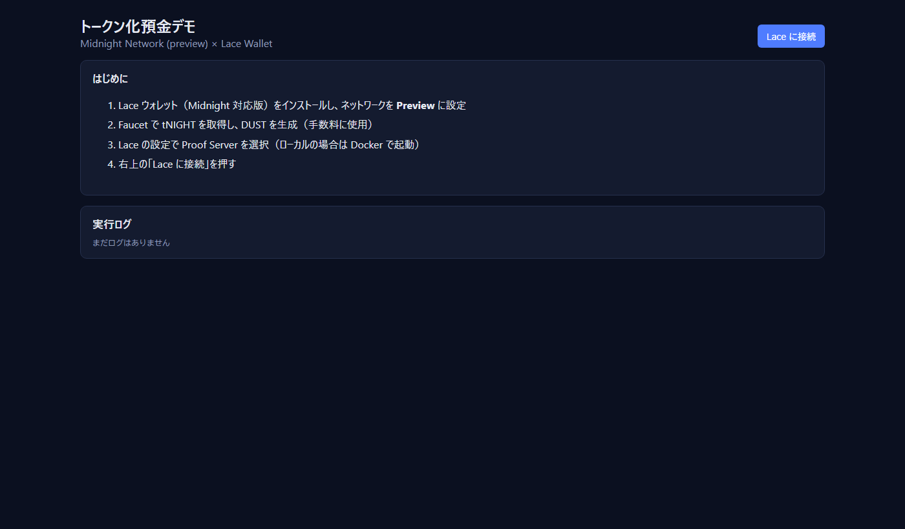
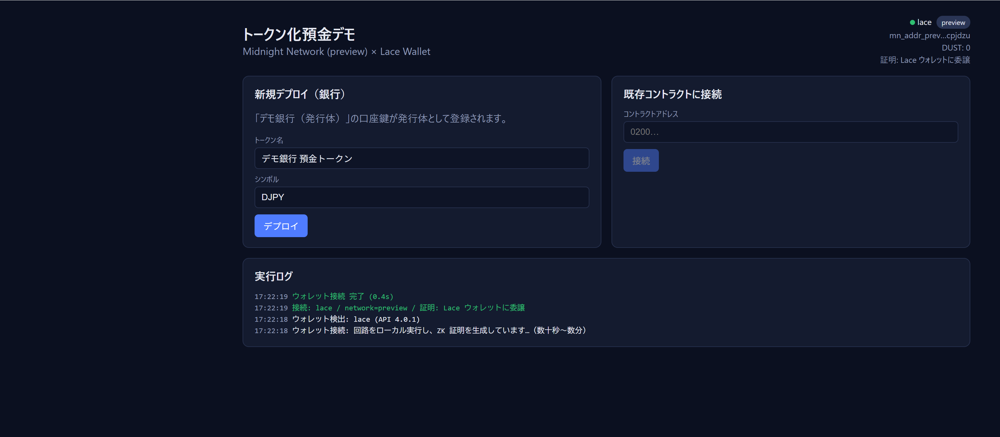

# トークン化預金デモ（Midnight Preview × 1AM / Lace）

Midnight ブロックチェーン上で、銀行が発行する **トークン化預金** の
**発行・移転・償還・強制移転・強制償還・凍結・全体停止** を操作できるデモ DApp です。

| 項目 | 内容 |
|---|---|
| ネットワーク | Midnight **Preview**（2026-11-07 に ledger 9 の新しいチェーンとして再起動） |
| ウォレット | **1AM**（推奨）または Lace（Midnight 対応版、DApp Connector API v4）。※Lace の Preview の接続先は 2026-11-10 時点で古いチェーンのまま（ISSUES.md #36） |
| コントラクト | Compact コンパイラ 0.36.0 / compact-runtime 0.21.0（`contract/tdeposit.compact`） |
| フロントエンド | Vite + midnight-js 5.0.0（ledger 9）、DApp Connector API 4.1.0 |
| Proof Server | 9.0.0（`proof-server.yml`） |
| 提供形態 | ① **Pactora UI 版**（`dist-pactora/`。**GitHub Pages で公開中**: https://101nimura.github.io/midnight_td_demo/ ） ② 開発サーバー版（`start-dev.cmd`） ※旧版の単一 HTML（`dist-single/tdeposit-demo.html`）は ledger 8 用で、今の Preview では動かない |

取得: `git clone https://github.com/101nimura/midnight_td_demo.git`（環境構築は SETUP.md を参照）

関連ドキュメント

- 環境を一から作る手順: [`docs/SETUP.md`](docs/SETUP.md)（スライド版: `docs/SETUP.pptx`）※2026-11-10 改訂（ledger 9・1AM・Pactora デモ）。デモを動かすだけならコース A（1AM + tNIGHT + DUST）
- Midnight でトークン化預金を実現する際の課題（重要度別の整理版）: [`docs/TOKENIZED_DEPOSIT_ISSUES.md`](docs/TOKENIZED_DEPOSIT_ISSUES.md)
- デモ作成中に発生した問題・課題の記録（時系列）: [`docs/ISSUES.md`](docs/ISSUES.md)

---

## 0. 2026-11-10 の更新（ledger 9 対応）

Preview の再起動（ledger 9）に合わせて、デモ一式を更新しました（ISSUES.md #35〜#38）。以下の章の「Lace」は、使うウォレット（1AM など）に読み替えてください。

| 変更点 | 内容 |
|---|---|
| SDK | midnight-js 4.1.1 → **5.0.0**、compact-runtime 0.16.0 → **0.21.0**、コンパイラ 0.31.1 → **0.36.0**、DApp Connector API 4.0.1 → **4.1.0** |
| Proof Server | 8.0.3 → **9.0.0**。`docker compose -f proof-server.yml up -d` で新しいイメージに入れ替わる（初回はパラメータの取得に数分） |
| ウォレット | 1AM を優先して使う（両方入っている場合）。手数料の支払い・証明の生成はウォレットに委譲 |
| チェーンの読み取り | 公式の Preview インデクサ（`indexer.preview.midnight.network`）に固定。ウォレットの接続先に左右されない |
| 配布形態 | 単一 HTML をやめ、**フォルダ（HTML + assets/ + keys/ zkir/ compiler/）** で配信。ZK 鍵が約 108MB になり HTML に埋め込めないため（#38） |
| GitHub Pages | GitHub Actions でビルドして公開（ビルド結果はコミットしない） |
| 旧データ | 11/2 にデプロイしたコントラクト・tNIGHT・DUST は新しいチェーンにない。Faucet での再取得と、デプロイのやり直しが必要 |

### デモの起動（毎回）

1. Rancher Desktop を起動し「Running」を待つ → リポジトリのフォルダで `docker compose -f proof-server.yml up -d` → http://localhost:6300/version が **9.0.0**
   （1AM はウォレット側の証明（Proof Station / WASM）を使えるため、Proof Server が不要な場合もあります）
2. 1AM のネットワークが **Preview**、tNIGHT と **DUST が 0 より大きい** ことを確認（Faucet: https://faucet.preview.midnight.network/ ）
3. https://101nimura.github.io/midnight_td_demo/ を開く（ローカルなら `build-pactora.cmd` → `start-pactora.cmd` → http://localhost:8081/pactora-tdeposit-demo.html ）
4. S-1「業務 01 を始める」→ S-2「ウォレットに接続」→ ログイン → 左のガイドのステップ 1「提供を開始（デプロイ）」から順に進める
---

## 1. デモの概要

### 1.1 できること

| 区分 | 操作 | 回路 | 説明 |
|---|---|---|---|
| 銀行 | 口座登録（KYC） | `registerAccount` | KYC 済みの口座IDをホワイトリストに登録 |
| 銀行 | 発行 | `issue` | 入金に応じてトークンを発行（発行残高が増える） |
| 銀行 | 強制移転 | `forceTransfer` | 裁判所命令・誤送金の訂正など。凍結中・停止中でも実行できる |
| 銀行 | 強制償還 | `forceRedeem` | 口座解約・差押えなどに伴うトークンの消却 |
| 銀行 | 凍結 / 解除 | `freezeAccount` / `unfreezeAccount` | 対象口座の移転・償還を禁止 / 解除 |
| 銀行 | 全体停止 / 解除 | `pause` / `unpause` | 緊急時に利用者の操作と新規発行を止める |
| 利用者 | 移転（送金） | `transfer` | 登録済み口座の間で送金 |
| 利用者 | 償還（払戻し） | `redeem` | トークンを消却して預金へ払い戻す（法定通貨はオフチェーン） |

### 1.2 しくみ（押さえておくと操作が分かりやすい点）

- **口座鍵と口座ID**
  各口座は 32 バイトの「口座鍵（秘密鍵）」を持ちます。チェーン上に記録されるのは
  `口座ID = ハッシュ("tdeposit:acct:" + 口座鍵)` だけです。
  回路は口座鍵から口座IDを計算し直し、「自分が発行体（銀行）である」「自分がこの口座の持ち主である」ことを、**口座鍵を公開せずに**ゼロ知識証明します。
- **1 つのブラウザで複数の登場人物を操作**
  口座鍵はブラウザ（localStorage）に保存します。初期状態で「デモ銀行（発行体）」「利用者A」「利用者B」の 3 つが作られ、画面で切り替えて操作します。
- **手数料はすべて Lace が払う**
  どの登場人物で操作しても、トランザクションの手数料（DUST）は接続中の Lace ウォレットが支払います。口座鍵と Lace の鍵は別物です。
- **残高は公開台帳**
  強制移転・凍結を確実に行うため、残高はコントラクトの公開台帳で管理しています。画面の「口座一覧」「操作履歴」は誰でも参照できる情報です（課題は ISSUES.md #4, #11）。

---

## 2. 事前準備（チェックリスト）

環境の作り方は [`docs/SETUP.md`](docs/SETUP.md) にあります。デモを始める前に、毎回次の項目を確認してください。**上から順に確認するのが大事です。**特に Docker は、起動しきる前に操作するとエラーになります。

| # | 確認項目 | 確認方法 | 期待する結果 |
|---|---|---|---|
| 1 | Rancher Desktop が起動しきっている | タスクトレイのアイコン / 画面下部の表示 | 「Running」。Kubernetes が有効だと数分かかる |
| 2 | Docker が使える | `docker info` | エラーではなく、サーバー情報が表示される |
| 3 | Proof Server が動いている | ブラウザで http://localhost:6300/version を開く | `8.0.3` と表示される |
| 4 | Lace のネットワーク | Lace → 設定 → Midnight | **Preview** |
| 5 | Lace の証明サーバー | Lace → 設定 → Midnight設定 | 「カスタムプルーフサーバー」`http://localhost:6300` |
| 6 | DUST がある | デモ画面で接続後、右上の「DUST」 | **0 より大きい**（0 だとすべての操作が手数料不足で失敗する） |

Proof Server が起動していない場合:

```powershell
# リポジトリのフォルダ（例: C:\work\midnight_td_demo）で実行
docker compose -f proof-server.yml up -d
```

> `certs\ca-bundle.crt` がないと、Proof Server は起動できません（社内の TLS 検査がある環境では、起動直後に停止します）。クローンした直後は `make-ca-bundle.cmd` を一度実行してください（SETUP.md の 5.2）。

---

## 3. 起動方法

### 3.1 開発サーバー版（通常はこちら）

```bat
start-dev.cmd
```

PowerShell から直接実行する場合（リポジトリのフォルダで）:

```powershell
wsl -d Ubuntu --cd . -- bash .tools/npm.sh run dev
```

> 初めて起動する前に、`npm-install.cmd` で依存パッケージを入れておきます（SETUP.md の 8.1）。

`Local: http://localhost:5173/` と表示されたら、Chrome / Edge で **http://localhost:5173** を開きます。

| 症状 | 原因と対処 |
|---|---|
| `Port 5173 is already in use` | 別の開発サーバーがすでに起動しています。そのウィンドウで Ctrl+C を押して止めるか、そのまま既存のサーバーを使ってください |
| コードを変えたのに画面が変わらない | `vite.config.ts` を変えた場合は、サーバーの再起動（Ctrl+C → 再実行）が必要です。ソースの変更は自動で反映されます（ポーリング監視） |

### 3.2 単一 HTML 版

アプリ全体（JS / CSS / WASM / ZK 証明鍵）を 1 つの HTML に埋め込んだ版です。ファイルサイズは約 55MB です。

**ビルド**（コントラクトや画面を変更したとき）:

```bat
build-single.cmd
```

→ `dist-single\tdeposit-demo.html` ができます。

**開き方 A（推奨）: ローカルの HTTP サーバーで配信**

```bat
start-single.cmd
```

→ http://localhost:8080/tdeposit-demo.html を開きます（Windows の Python を使います）。

**開き方 B: ファイルを直接開く（非推奨）**

> Lace のバージョンによっては、下の設定を ON にしても `file://` のページに組み込まれず、「Lace が見つかりません」になります（ISSUES.md #33）。その場合は開き方 A を使ってください。

1. Chrome / Edge の拡張機能の管理画面 → Lace の「詳細」→ **「ファイルの URL へのアクセスを許可する」を ON** にします
   （OFF のままだと Lace がページに組み込まれず、「Lace が見つかりません」になります）
2. `tdeposit-demo.html` をブラウザにドラッグ＆ドロップします

> 初回は 55MB の読み込みと WASM の準備に十数秒かかります。画面が真っ暗なまま数秒たっても、そのまま待ってください。
> 開いた URL（`localhost:5173` / `localhost:8080` / `file://`）ごとに、ブラウザの保存領域は別になります。口座鍵とコントラクトアドレスは引き継がれないので、同じコントラクトを使うには「既存コントラクトに接続」でアドレスを入力してください。

### 3.3 Pactora UI 版

画面と挙動を Pactora の画面モック（`pactora-phase2-usecase-mock.html` の業務 01 トークン化預金）に合わせた版です。コントラクトと Lace への接続は 3.1・3.2 と同じものを使います。

| 項目 | 内容 |
|---|---|
| ファイル | `dist-pactora/`（`pactora-tdeposit-demo.html` + `assets/`（JS・WASM 約 26MB）+ `keys/` `zkir/` `compiler/`（ZK 鍵 約 108MB））。フォルダごと配信する |
| ビルド | `build-pactora.cmd`（= `npm run build:pactora`） |
| 公開 URL | https://101nimura.github.io/midnight_td_demo/ （GitHub Pages。src・contract/managed などを main に push すると、GitHub Actions がビルドして自動で更新。`.github/workflows/pages.yml`） |
| 開き方（ローカル） | `start-pactora.cmd` → http://localhost:8081/pactora-tdeposit-demo.html（`file://` で直接開くと Lace が組み込まれないことがあるため、この方法を推奨） |
| 開発サーバー | `start-dev.cmd` → http://localhost:5173/pactora.html |
| ソース | `pactora.html`、`src/pactora/`（`app.ts` 画面と操作、`pactora.css` モックから流用した CSS） |

画面の流れはモックと同じで、業務選択（S-1）→ 環境の準備（S-2：Lace の接続・DUST・口座鍵・コントラクト）→ ログイン（L-1）→ 左の**ガイド**に沿って 15 ステップを進めます。

| フェーズ | 操作するユーザー | 画面 | Midnight 上の操作 |
|---|---|---|---|
| 提供開始 | △△銀行 | 資金トークン 一覧（M-1） | デプロイ |
| 口座開設（KYC） | △△銀行 | 口座管理（M-4） | `registerAccount` × 2 |
| 入金（mint） | 投資家A → △△銀行 | 資金（I-3）→ 発行・償還（M-3） | 申込はオフチェーン → `issue` |
| 誤送金と強制移転 | 投資家A → Pactora運用 → △△銀行 | I-3 → 保有・取引履歴（I-4）→ Recovery（M-8）→ 強制移転の承認（M-8） | `transfer` → 返却依頼・申請はオフチェーン → `forceTransfer` |
| 凍結 | △△銀行 → 投資家B → △△銀行 | M-4 → I-3 → M-4 | `freezeAccount` → `transfer`（コントラクトが拒否）→ `unfreezeAccount` |
| 出金（burn） | 投資家A → △△銀行 | I-3 → M-3 | `redeem` → 普通預金への入金はオフチェーン |
| 照合・監査 | Pactora運用・監察機関 | 預金台帳・照合（M-5）・監査ログ（AD-4） | 状態の参照のみ |

- モックの「署名リクエスト」を押すと、実際に ZK 証明 → **Lace の承認** → 送信 → ブロック取り込みが進みます（進捗はダイアログと「Midnight 実行ログ」（AD-6）に表示されます）。
- 普通預金（勘定系）、入出金の申込、返却依頼、強制移転の申請、照合結果、操作ログ（Tx ハッシュ）は、このブラウザの localStorage に保存する模擬データです。
- 口座鍵は「ウォレット・口座鍵」または S-2 からエクスポート／インポートできます（別のブラウザ・別の URL で同じ銀行の鍵を使う場合）。
- 左下の「初期化」では「業務データだけ初期化」と「新しいコントラクトで最初から」を選べます（チェーン上の記録は消えません）。
- モックの資産サイド（社債 ST・DvP）は、コントラクトにないため対象外です（課題 M8）。

---

## 4. 画面の構成



| 領域 | 内容 |
|---|---|
| 右上 | Lace の接続状態、アドレス、**DUST 残高 / 上限**（「再取得」で更新）、DUST アドレス、証明の方式 |
| コントラクト | デプロイ / 既存コントラクトへの接続、接続中のコントラクトアドレス |
| ダッシュボード | トークン名、発行残高、累計発行、累計償還、登録口座数、稼働中 / 全体停止中 |
| 操作者の選択 | 口座鍵（銀行・利用者A・利用者B …）の切り替えと追加、口座IDのコピー、残高 |
| オペレーション | 「🏦 銀行（発行体）」と「👤 利用者」のタブ |
| 口座一覧 | 公開台帳上の全口座の残高と状態 |
| 操作履歴 | オンチェーンに記録された全操作 |
| 実行ログ | 証明の生成・承認・送信の進み具合とエラー（**困ったらまずここを見る**） |

---

## 5. 操作手順

> **全操作に共通**
> 1. ボタンを押すと、ブラウザ内で回路を実行し、Proof Server で ZK 証明を作ります（数十秒〜数分）
> 2. **Lace の承認画面が出るので承認**します（手数料 DUST の支払い）
> 3. 送信後、ブロックに取り込まれると画面の数値が自動で更新されます
>
> 処理中は画面上部に「処理中: ○○」と表示され、ほかの操作はできません。

### 5.1 Lace に接続する

1. 右上の **「Lace に接続」** を押します
2. Lace のポップアップで接続を承認します
3. 実行ログに次のような行が出れば成功です
   - `接続: lace / network=preview / 証明: Lace ウォレットに委譲`
   - `DUST 残高=… / 上限=… / NIGHT(unshielded)=…`



- 右上の **DUST が 0 なら、ここで止めてください**。SETUP.md の「7. DUST を用意する」を行います
- 「ネットワーク (…) が preview ではありません」と出たら、Lace の設定で Preview に切り替えます

### 5.2 コントラクトをデプロイする（初回のみ）

1. 「新規デプロイ（銀行）」で、トークン名（例: `デモ銀行 預金トークン`）とシンボル（例: `DJPY`）を入力します
2. **「デプロイ」** を押し、Lace で承認します
3. 数分待つと「デプロイ完了: 0200…」と表示され、ダッシュボードが出ます
4. 表示された**コントラクトアドレスは控えておきます**（ブラウザに保存され、次回からは自動で入力されます）

> デプロイした時点で「デモ銀行（発行体）」の口座鍵が発行体として登録されます。この口座鍵をなくすと、銀行の操作が一切できなくなります（ISSUES.md #5, #6）。

### 5.3 既存のコントラクトに接続する（2 回目以降 / 別のブラウザから）

1. 「既存コントラクトに接続」にコントラクトアドレスを入力し、**「接続」** を押します
2. 銀行の操作をするには、デプロイしたときと**同じ銀行の口座鍵**が必要です。別のブラウザでは銀行の口座鍵が別のものになるため、銀行の操作は権限エラーになります

### 5.4 操作者を切り替える

「操作者（口座鍵）の選択」で、カードを押すと操作者が切り替わります。

- カードの表示: `発行体` / `登録済` / `未登録`、口座ID、残高、凍結の有無
- **「ID コピー」**: 口座IDをコピーします（ほかの人に送金先として伝える場合など）
- **口座鍵の追加**: 名前を入れて「口座鍵を追加」を押すと、新しい利用者を作れます

### 5.5 銀行（発行体）のオペレーション

操作者を **「デモ銀行（発行体）」** にし、「🏦 銀行（発行体）オペレーション」タブを開きます。

| 操作 | 手順 | 失敗する主なケース |
|---|---|---|
| **口座登録** | 「登録する口座」で利用者を選ぶ → 登録 | すでに登録済み |
| **発行** | 発行先を選ぶ → 金額を入れる → 発行 | 未登録の口座 / 全体停止中 / 金額が 0 |
| **強制移転** | 移転元・移転先・金額を指定 → 強制移転 | 残高不足 / 移転元と移転先が同じ |
| **強制償還** | 対象口座・金額を指定 → 強制償還 | 残高不足 |
| **凍結 / 解除** | 対象口座を選ぶ → 凍結 / 解除 | すでに凍結中 / 凍結されていない |
| **全体停止 / 解除** | ボタンを押すだけ | — |

- 「口座ID を直接入力…」を選ぶと、ほかのブラウザで作った口座ID（64 桁の 16 進数）を指定できます
- 発行体ではない操作者で実行すると、**回路の中で権限エラー**（`発行体（銀行）のみ実行できます`）になります。権限チェックが働くことを見せたいときに使えます

### 5.6 利用者のオペレーション

操作者を **利用者A / 利用者B** にし、「👤 利用者オペレーション」タブを開きます。

| 操作 | 手順 | 失敗する主なケース |
|---|---|---|
| **移転（送金）** | 送金先を選ぶ → 金額を入れる → 送金 | 残高不足 / 自分か相手が凍結中 / 全体停止中 / 未登録 |
| **償還** | 金額を入れる → 償還 | 残高不足 / 凍結中 / 全体停止中 |

タブの上に、現在の操作者の残高と状態（未登録 / 凍結中）が表示されます。

### 5.7 結果を確認する

- **ダッシュボード**: 発行残高 = 累計発行 − 累計償還 になっていること
- **口座一覧**: 各口座の残高と状態
- **操作履歴**: 種別（発行 / 移転 / 強制移転 …）、From / To、金額。番号の新しい順に並びます

---

## 6. デモシナリオ（所要 30〜60 分）

1 回の操作に 1〜数分かかります（証明の生成 → Lace での承認 → ブロックへの取り込み）。

| # | 操作者 | 操作 | 見せるポイント |
|---|---|---|---|
| 1 | 銀行 | 利用者A を口座登録 | KYC 済みの口座だけが参加できる |
| 2 | 銀行 | 利用者B を口座登録 | |
| 3 | 銀行 | 利用者A に 100,000 発行 | 発行残高が増える |
| 4 | 利用者A | 利用者B へ 30,000 送金 | 口座鍵を見せずに本人であることを証明して送金 |
| 5 | 利用者B | 5,000 償還 | 発行残高が減り、累計償還が増える |
| 6 | 利用者A | 「銀行」タブで発行を試す | **権限エラー**（発行体ではない） |
| 7 | 銀行 | 利用者A を凍結 | |
| 8 | 利用者A | 利用者B へ送金を試す | **凍結エラー** |
| 9 | 銀行 | 利用者A → 利用者B へ 20,000 強制移転 | 凍結中でも銀行は移転できる |
| 10 | 銀行 | 利用者B から 10,000 強制償還 | |
| 11 | 銀行 | 全体停止 → 利用者B で送金を試す | **停止エラー** |
| 12 | 銀行 | 停止解除・凍結解除 | 元の状態に戻る |

---

## 7. うまくいかないとき

| 症状（実行ログ / 画面） | 原因 | 対処 |
|---|---|---|
| 「Lace ウォレットが見つかりません」 | Lace が無効 / `file://` で開いている（許可設定を ON にしても組み込まれないことがある。ISSUES.md #33）/ Lace の「サイトへのアクセス」が制限されている | 拡張機能を有効にする / **開き方 A（http://localhost）を使う** / Lace の「サイトへのアクセス」を「すべてのサイト」にする。エラーメッセージの末尾に、開いている URL と見つかったウォレットが表示されます |
| 「ネットワーク (…) が preview ではありません」 | Lace のネットワークが違う | Lace の設定で Preview を選ぶ |
| 右上の DUST が 0 | DUST を生成していない / 生成直後でまだたまっていない | SETUP.md の「7.」。生成後、数分〜十数分待って「再取得」を押す |
| デプロイ・操作が長時間止まる、証明のエラー | Proof Server が動いていない | http://localhost:6300/version を確認。止まっていれば `docker compose -f proof-server.yml up -d` |
| Proof Server がすぐ止まる（`docker ps` に出ない） | 社内 TLS 検査で、起動時のダウンロードに失敗している | `make-ca-bundle.cmd` を実行してから起動し直す（SETUP.md 5.2） |
| `docker` が `//./pipe/docker_engine` エラーになる | Rancher Desktop が起動しきっていない | 「Running」になるまで待つ |
| `発行体（銀行）のみ実行できます` | 操作者が銀行ではない / 別のブラウザで作った銀行の口座鍵 | 操作者を銀行に切り替える / デプロイしたブラウザで操作する |
| `未登録の口座です` / `残高不足です` / `凍結されています` / `システム停止中です` | 業務ルールのチェック（正常な動作） | 状態を直してから再実行する |
| Lace で承認したあとに失敗する | ほかの操作と同時に実行して競合した / DUST 不足 | 少し待って再実行する（ISSUES.md #12） |

ブラウザの開発者ツール（F12）の Console にも、詳しいエラーが出ます。

---

## 8. ファイル構成

```
contract/
  tdeposit.compact          Compact コントラクト本体
  managed/tdeposit/         コンパイル結果（JS バインディング・ZKIR・証明鍵）
src/
  contract/index.ts         コントラクトの TS バインディング・ウィットネス
  midnight/wallet.ts        Lace への接続（DApp Connector API v4）、プロバイダの構築、DUST 状態の取得
  midnight/tdepositApi.ts   デプロイ / 接続 / 各回路の呼び出し / 状態の購読
  midnight/identities.ts    デモ用の口座鍵（銀行・利用者）の管理
  midnight/embeddedZk.ts    単一 HTML 版用: HTML に埋め込んだ ZK 鍵の提供
  App.tsx, styles.css       画面
test/tdeposit.test.ts       ローカルシミュレータでの業務ロジックテスト（9 件）
tools/dust/designate.ts     DUST 生成先の指定ツール（Lace で DUST を生成できない場合）
proof-server.yml            ローカル Proof Server（社内 CA バンドルに対応）
vite.config.ts              開発サーバー版の設定
vite.single.config.ts       単一 HTML 版の設定
docs/                       SETUP（環境構築）/ ISSUES（課題）/ images
*.cmd                       Windows から実行するためのスクリプト
```

| コマンド | 内容 |
|---|---|
| `npm-install.cmd` | 依存パッケージのインストール（クローン直後・package.json 更新時） |
| `start-dev.cmd` | 開発サーバー版を起動（http://localhost:5173） |
| `build-single.cmd` / `start-single.cmd` | 単一 HTML 版のビルド / 配信（http://localhost:8080） |
| `compile-contract.cmd` | コントラクトのコンパイル（`tdeposit.compact` を変更したときのみ。ZK 鍵の生成を含み数分かかる） |
| `run-tests.cmd` | コントラクトのシミュレータテスト |
| `make-ca-bundle.cmd` | Proof Server 用の CA バンドルを作成（クローン直後に 1 回。社内 TLS 検査があれば社内証明書も取り込む） |
| `dust-install.cmd` / `dust-designate.cmd <DUSTアドレス>` | DUST 代替ツールのインストール / 実行 |

---

## 9. 注意事項

- 本デモは検証用です。口座鍵を localStorage に平文で保存する、デモ用ウォレットのシードをファイルに保存する、など本番には向かない実装を含みます。
- 残高・送金額・口座IDは公開台帳で誰でも参照できます。
- Preview は開発用のネットワークです。リセットされたり、仕様が変わったりすることがあります（コンパイラ・SDK・Proof Server のバージョンの組み合わせに注意。ISSUES.md #8）。
