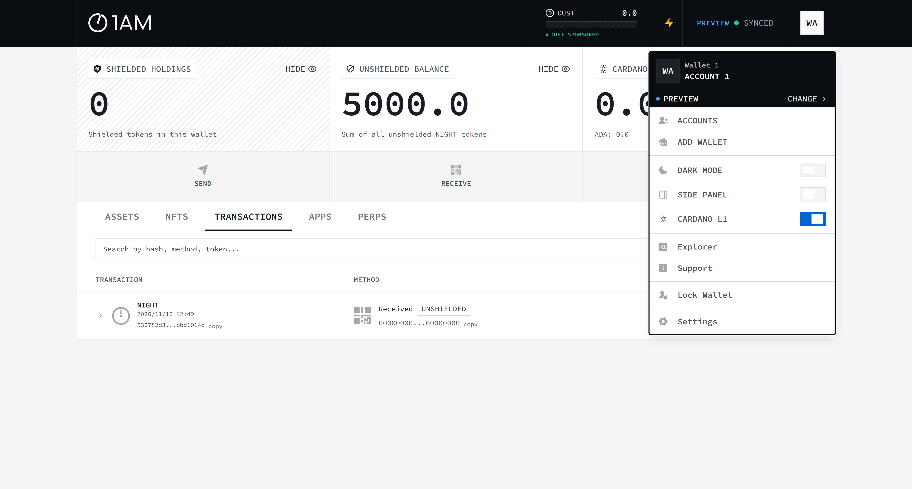
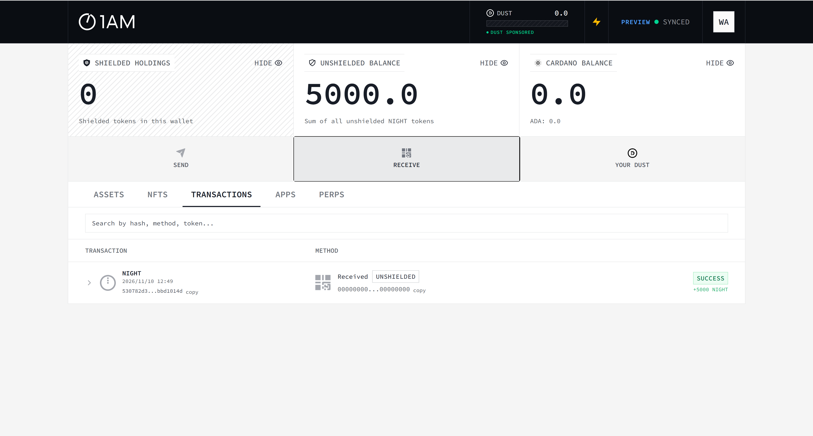
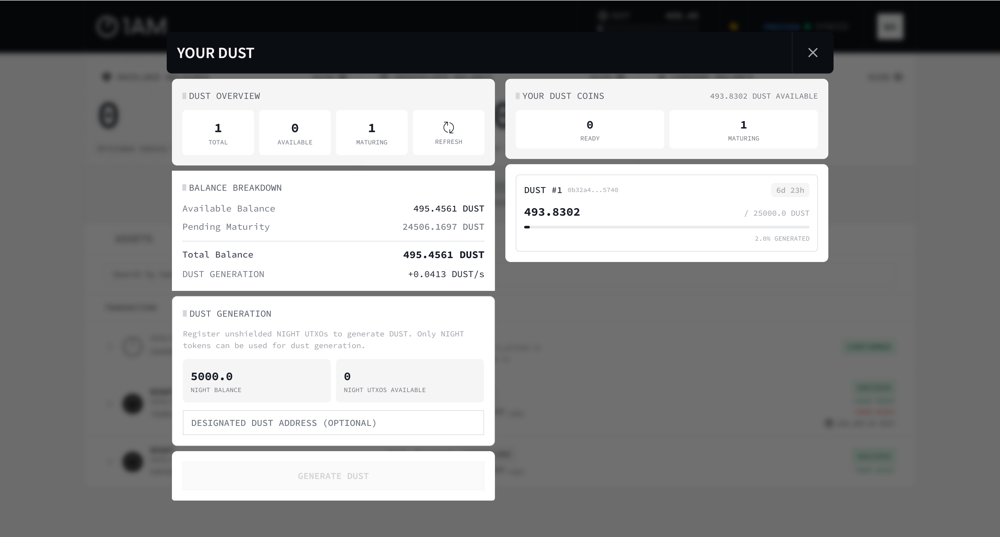
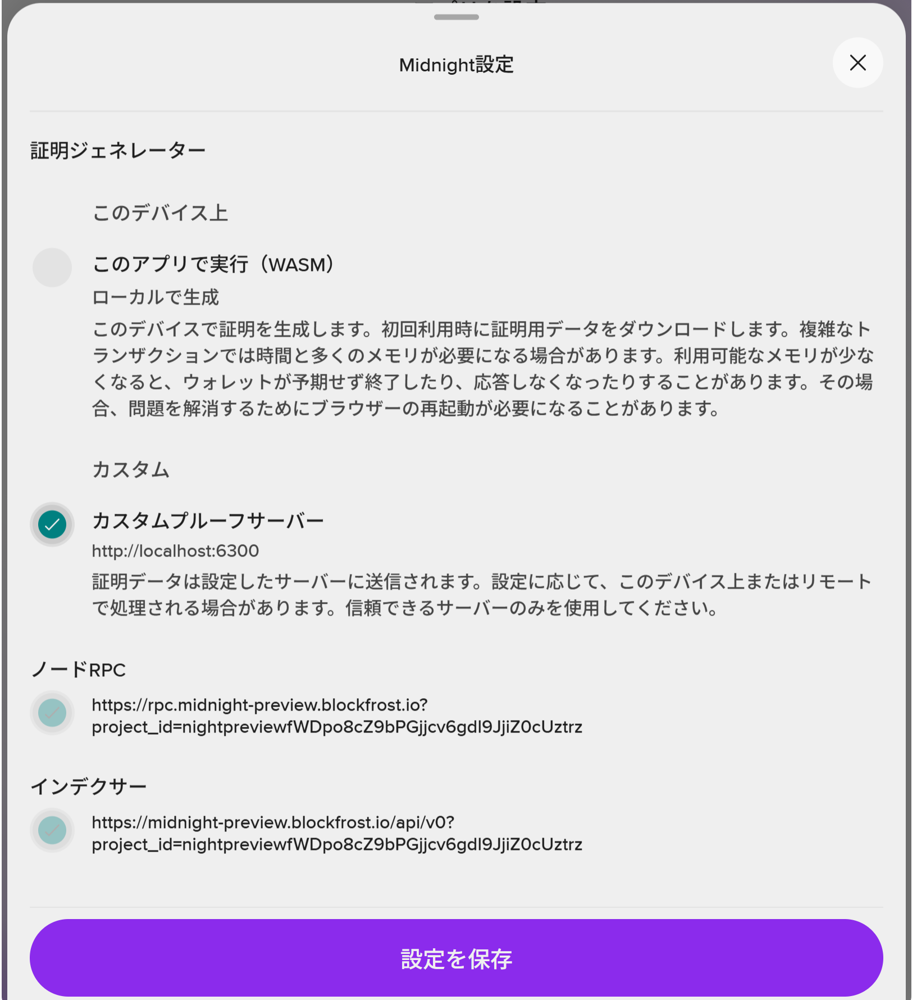

# Midnight 開発環境 構築手順書（Windows 版）

Windows 11 の PC で、Midnight（Preview ネットワーク）の DApp を**開発するための環境**を一から作る手順です。特定のアプリに依存しない、開発環境そのものの手順です。

- 本リポジトリのデモ（Pactora トークン化預金デモ）の動かし方は、[README.md](../README.md) を参照してください
- 想定する読者: Windows で開発をしている人。ブロックチェーンの経験は不要です
- 所要時間: 約 2〜3 時間（ダウンロード・DUST がたまるのを待つ時間を含みます）
- 本書は、実際に構築したときのつまずき（2026-11-02 の初版、2026-11-10 の改訂）を踏まえて、**つまずきにくい順序**で書いています。順番どおりに進めてください

> **2026-11-10 改訂のポイント**（初版から大きく変わった点）
>
> | 項目 | 初版（11/2） | 改訂（11/10） | 理由 |
> |---|---|---|---|
> | Preview ネットワーク | ledger 8 のチェーン | **11/7 に ledger 9 の新しいチェーンとして再起動** | 公式の更新。初版で用意した tNIGHT・DUST・コントラクトは消えた（ISSUES.md #35） |
> | Compact コンパイラ | 0.31.1 | **0.36.0** | ledger 9 への対応（#37, #38） |
> | SDK | midnight-js 4.1.1 | **midnight-js 5.0.0** | 同上 |
> | Proof Server | 8.0.3 | **9.0.0** | 同上 |
> | ウォレット | Lace | **1AM**（Lace は今の Preview で使えない） | Lace の接続先（Blockfrost）が古いチェーンのまま止まっている（#36） |
> | DUST の用意 | 代替ツール（`dust-designate.cmd`） | **1AM の画面で生成** | ツールは ledger 8 用で使えない（#38） |

---

## 0. 全体像

### 0.1 構成

```
 Windows 11
 ├─ Chrome / Edge
 │    ├─ 開発中の DApp（開発サーバー http://localhost:5173 など）
 │    └─ 1AM ウォレット拡張 ─── 手数料(DUST)の支払い・署名・ZK 証明（ウォレット側でも作れる）
 │
 ├─ Rancher Desktop（Docker）
 │    └─ Proof Server 9.0.0  http://localhost:6300   ← ZK 証明を作る（CLI・テスト・ローカルでの証明に使う）
 │
 └─ WSL2 (Ubuntu)
      ├─ Node.js 24（nvm）         ← ビルド・テスト・開発サーバー
      └─ Compact コンパイラ 0.36.0 ← コントラクトのコンパイル

 Midnight Preview ネットワーク（インターネット）
      ├─ Node (RPC) / Indexer（公式: *.preview.midnight.network）
      └─ Faucet（テスト用 tNIGHT の配布）
```

### 0.2 なぜこの構成なのか（先に知っておくと迷わない点）

| 判断 | 理由 |
|---|---|
| ビルドを **WSL2** で行う | Compact コンパイラは Linux / macOS 版しかありません。SDK は Node.js 22.12 以上が必要で、Windows 側の Node の影響を受けないように分けます |
| Docker は **Rancher Desktop** | Proof Server は Docker イメージで提供されています（Docker Desktop でも構いません） |
| **バージョンを固定**する（付録 A） | コンパイラ・ランタイム・SDK・Proof Server・ウォレットの組み合わせが厳密に決まっています。公式の対応表（docs.midnight.network の Support matrix）に合わせます |
| ウォレットは **1AM** | Lace は、Preview の接続先（Blockfrost）がリセット前の古いチェーンのまま止まっていて、残高も取引も正しく扱えません（2026-11-10 時点）。Lace の接続先は利用者も DApp も変更できません |
| DApp は状態の読み取りに **公式の Indexer** を使う（推奨） | ウォレットの接続先に障害があっても、コントラクトの状態を読めるようにするためです（付録 B） |

### 0.3 用語

| 用語 | 意味 |
|---|---|
| **Preview** | Midnight の公開テストネット。**予告なくリセット（作り直し）されることがある**。リセットされると tNIGHT・DUST・コントラクトがすべて消える |
| **ledger 8 / ledger 9** | Midnight の台帳の版。2026-11 に 9 へ移行した。版が違う SDK・コンパイラ・Proof Server は使えない |
| **tNIGHT** | Preview 用の NIGHT トークン。Faucet で無料でもらえる |
| **DUST** | 手数料に使うリソース。NIGHT を「DUST 生成」に登録すると、**時間とともに少しずつたまる**。tNIGHT を受け取っただけでは増えない |
| **Proof Server** | トランザクションのゼロ知識証明を作るサーバー。手元の Docker で動かす |
| **unshielded / shielded / DUST アドレス** | Midnight のウォレットには 3 種類のアドレスがある。Faucet の送り先は **unshielded アドレス**（`mn_addr_preview1…`） |

### 0.4 作業の流れ

| 章 | 作業 | 目安 |
|---|---|---|
| 1 | 事前確認（権限・ネットワーク・Preview の状態）、Git | 15 分 |
| 2 | WSL2 と Ubuntu | 20 分 |
| 3 | Node.js（WSL 内） | 10 分 |
| 4 | Compact コンパイラ（WSL 内） | 10 分 |
| 5 | Rancher Desktop と Proof Server | 30 分 |
| 6 | 1AM ウォレット | 15 分 |
| 7 | tNIGHT と DUST を用意する | 10〜30 分 |
| 8 | 開発環境の確認（サンプルのコンパイル・テスト・ビルド） | 20 分 |

---

## 1. 事前確認

### 1.1 必要なもの

- Windows 11（WSL2 が使えること）
- **管理者権限**（WSL と Rancher Desktop のインストールで必要）
- メモリ 16GB 以上を推奨（Proof Server とブラウザ内の証明処理はメモリを多く使います）
- ディスクの空き 20GB 以上
- Chrome または Edge（拡張機能を追加できること）

### 1.2 社内ネットワークの確認（重要）

社内のプロキシや **TLS 検査（Netskope / Zscaler など）** がある環境では、Docker コンテナからの HTTPS 通信が失敗します。後の 5.2 で対処するので、先に該当するかどうかを確認しておきます。PowerShell で次を実行します。

```powershell
Get-ChildItem Cert:\LocalMachine\Root | Where-Object { $_.Subject -like '*netskope*' -or $_.Subject -like '*zscaler*' } | Select-Object Subject
```

- 何か表示された → **TLS 検査あり**。5.2 で社内の証明書を取り込みます
- 何も表示されない → TLS 検査なし（5.2 は同じ手順で実行します。標準の証明書だけで作成されます）

> Windows 標準の `curl.exe` は、社内環境で証明書の失効確認に失敗することがあります（`CRYPT_E_NO_REVOCATION_CHECK`）。接続確認で使う場合は `--ssl-no-revoke` を付けてください。

### 1.3 コマンドを実行する場所（PowerShell・WSL・Git Bash）

本書のコマンドは、特に断りがなければ **PowerShell** で実行します。

| 実行する場所 | 注意点 |
|---|---|
| **PowerShell** | 基本はここ。`*.cmd`（Windows のバッチファイル）は `.\xxx.cmd` で実行する |
| **WSL の bash**（`user@PC:/mnt/c/...$`） | `$` で始まる行はここで実行する。**`*.cmd` はここでは動かない**（`.\xxx.cmd: command not found`。11/10 に実際に発生） |
| Git Bash | `wsl` を呼ぶとパスが書き換えられて失敗する（`/mnt/c/...` が `C:/Program Files/Git/mnt/c/...` になる）。使う場合は先頭に `MSYS_NO_PATHCONV=1` を付ける |

### 1.4 Git のインストール

`git --version` でバージョンが表示されれば不要です。表示されない場合は、https://git-scm.com/download/win からインストールします。設定はすべて既定のままで構いません。

### 1.5 Preview の状態を確認する（毎回・作業の前に）

Preview はリセットされることがあります（2026-11-07 に実際にリセットされました）。**以前に用意した tNIGHT・DUST・コントラクトが使えるか**を、作業の前に確認します。PowerShell で次を実行します。

```powershell
curl.exe -sS --ssl-no-revoke -H "Content-Type: application/json" -d '{\"query\":\"{ block { height timestamp } }\"}' https://indexer.preview.midnight.network/api/v4/graphql
```

- `{"data":{"block":{"height":…}}}` が返れば Preview は動いています
- **前回より `height`（ブロック高）が小さくなっていたら、リセットされています**。tNIGHT と DUST を取り直し（7 章）、コントラクトはデプロイし直します
- ledger の版が上がっていないかも確認します。最新の情報と対応表は公式ドキュメント（https://docs.midnight.network/guides/networks-and-environments ）にあります。版が上がっていたら、付録 A のバージョン一式を更新する必要があります

---

## 2. WSL2 と Ubuntu

### 2.1 インストール

管理者の PowerShell で実行します。

```powershell
wsl --install -d Ubuntu
```

再起動を求められたら再起動します。初回の起動時に、Ubuntu のユーザー名とパスワードを決めます。

### 2.2 確認

```powershell
wsl -l -v
```

`Ubuntu` が `VERSION 2` で表示されれば OK です。

> 本リポジトリのスクリプトは、ディストリビューション名を `Ubuntu` として動きます。別の名前（例: `Ubuntu-24.04`）を使う場合は、`[Environment]::SetEnvironmentVariable('WSL_DISTRO','Ubuntu-24.04','User')` を実行し、PowerShell を開き直してください。

---

## 3. Node.js（WSL 内）

WSL の Ubuntu に入ってから作業します。

```powershell
wsl -d Ubuntu
```

以降、`$` で始まる行は Ubuntu の中で実行します。

```bash
$ curl -fsSL https://raw.githubusercontent.com/nvm-sh/nvm/v0.40.3/install.sh | bash
$ source ~/.bashrc
$ nvm install 24
$ node -v      # v24.x と表示されれば OK（midnight-js 5.0.0 は 22.12 以上が必要）
```

> Windows 側の Node.js（`C:\Program Files\nodejs`）は使いません。古いままでも問題ありません。
> Windows の PATH は WSL に引き継がれ、空白を含むフォルダのせいで PATH の設定がおかしくなる場合があります。本リポジトリでは `.tools/env.sh` で PATH を設定し直してから各コマンドを実行するようにしています。

---

## 4. Compact コンパイラ（WSL 内）

```bash
$ curl --proto '=https' --tlsv1.2 -LsSf https://github.com/midnightntwrk/compact/releases/latest/download/compact-installer.sh | sh
$ source ~/.bashrc          # または export PATH="$HOME/.local/bin:$PATH"
$ compact update 0.36.0     # ★必ず対応表のバージョンに固定する
$ compact compile --version # 0.36.0 と表示されれば OK
```

> **注意 1: バージョンは対応表に合わせること**
> midnight-js 5.0.0 が受け付けるのは、ランタイム 0.21（コンパイラ 0.36.0）と 0.16（コンパイラ 0.31.1、ledger 8 の既存コントラクト用）だけです。0.33〜0.35 の出力は `EraMismatchError` で拒否されます。`compact update` をバージョン指定なしで実行すると、対応表より新しい版が入ることがあります。
>
> **注意 2: Windows の `compact.exe` と混同しないこと**
> Windows には NTFS の圧縮ツール `C:\Windows\System32\compact.exe` という同じ名前のコマンドがあります。PowerShell で `compact` を実行するとこちらが動きます。Compact コンパイラは**必ず WSL の中で**実行してください。
>
> 複数の版を入れておき、`compact update <版>` で既定を切り替えられます（`compact list --installed` で一覧）。

---

## 5. Rancher Desktop と Proof Server

### 5.1 Rancher Desktop のインストール

1. https://rancherdesktop.io/ から Windows 版をダウンロードしてインストールします（管理者権限が必要です）
2. 初回の起動時の設定:
   - **Container Engine: `dockerd (moby)`**（containerd を選ぶと `docker` コマンドが使えません）
   - Kubernetes: 不要なら OFF。ON のままだと起動に数分余計にかかります
3. **画面下部の表示が「Running」になるまで待ちます**

> 起動しきる前に `docker` を実行すると、次のエラーになります。故障ではないので、待ってからやり直してください。
> `error during connect: ... open //./pipe/docker_engine: The system cannot find the file specified.`

確認: `docker info` を実行し、サーバー情報（`Server Version: ...`）が表示されれば OK です。

### 5.2 Proof Server 用の CA バンドルを作る（全員）

Proof Server は起動時に、証明用のパラメータを **Amazon S3 からダウンロード**します。社内に TLS 検査があると、コンテナがその証明書を信頼できず、ダウンロードに失敗して停止します。

```
WARN midnight_base_crypto::data_provider: error sending request for url (https://midnight-s3-fileshare-dev-eu-west-1.s3...)
Error: ... Failed to fetch data from https://midnight-s3-fileshare-dev-eu-west-1... after 3 attempts. Giving up.
```

これを防ぐため、コンテナに渡す CA バンドルを作ります。本リポジトリのスクリプト（8.1 でクローン）を使う場合は、リポジトリのフォルダで実行します。

```powershell
.\make-ca-bundle.cmd
```

`certs\ca-bundle.crt` ができれば OK です。社内のルート証明書が見つかった場合は、`certs\netskope.pem` にも書き出されます。Zscaler など Netskope 以外の製品の場合は、`.tools\make-ca-bundle.ps1 -Pattern '*zscaler*'` のように製品名を指定してください。

> 本リポジトリの `proof-server.yml` はこのファイルを必ず読み込むので、**TLS 検査の有無にかかわらず**作ってください（TLS 検査がない環境では、標準の証明書だけで作られます）。
> 先に Proof Server を起動したい場合は、8.1 のクローンを先に行ってください。

### 5.3 Proof Server の起動

```powershell
docker compose -f proof-server.yml up -d
docker compose -f proof-server.yml logs -f     # 確認したら Ctrl+C で抜ける
```

`proof-server.yml` を使わずに起動する場合は、次と同じ内容です（イメージ `midnightntwrk/proof-server:9.0.0`、ポート 6300、CA バンドルを `/etc/ssl/certs/ca-certificates.crt` にマウント）。

- 初回（またはバージョンを変えた後）は、イメージとパラメータのダウンロードで数分かかります
- ログに `listening on: 0.0.0.0:6300` が出れば起動完了です
- ダウンロードしたパラメータはボリュームに保存されるので、2 回目以降の起動は速くなります

確認: ブラウザで http://localhost:6300/version を開き、**`9.0.0`** と表示されれば OK です。

> - PC を再起動したあとは、**Rancher Desktop が Running になってから** `docker compose -f proof-server.yml up -d` を実行します
> - `8.0.3` と表示される場合は、古いイメージのコンテナが動いています。`up -d` で入れ替えます
> - ブラウザの DApp からの証明は、ウォレット（1AM）が自分で作ることもできます（11/10 のデプロイでは Proof Server に証明の依頼は届きませんでした）。Proof Server は、CLI・テストの自動化・ローカルで証明したい場合（midnight-js の `httpClientProofProvider`）に使います

---

## 6. 1AM ウォレット

### 6.1 インストール

1. https://1am.xyz/ を開き、**Chrome の拡張機能**を追加します（Firefox 版・スマートフォン版もあります）
2. ブラウザ右上の拡張機能アイコン（パズルのマーク）から 1AM を**固定**しておくと、承認画面を開きやすくなります

> **Lace について**: Lace（Midnight 対応版）も DApp Connector API で DApp に接続できますが、2026-11-10 時点では Preview の接続先（Blockfrost）がリセット前の古いチェーンのまま止まっていて、使えません（9 章、付録 B）。

### 6.2 ウォレットを用意する（新規作成 または インポート）

**A. 新しく作る場合（推奨）**

1. 1AM を開き、ウォレットの作成を選びます
2. **リカバリーフレーズ**が表示されるので、**紙に書き写して安全な場所に保管**します
   - スクリーンショットやクラウドへの保存はしないでください
   - 開発・検証専用のウォレットにして、本番の資産とは分けてください
3. 確認の入力をして、1AM を開くときのパスワードを決めます

**B. 既存のウォレットをインポートする場合**

1. 1AM を開き、ウォレットの復元（リカバリーフレーズで復元）を選びます
2. 保管してあるリカバリーフレーズを入力し、パスワードを決めます
3. 同期が終わるまで待ちます

> ほかの人の PC にインポートする場合も、リカバリーフレーズを口頭やチャットで伝えないでください。新しく作る（A）ことを推奨します。

### 6.3 Preview を選んで同期を確認する

1. 1AM の右上のアカウント（`WA` など）を押し、メニューの上部が **`PREVIEW`** になっていることを確認します。違う場合は「CHANGE」で Preview に切り替えます
2. 画面右上に **`PREVIEW ● SYNCED`** と表示されれば、同期できています



### 6.4 アドレスを確認する

| アドレス | 形式 | 使い道 | 確認方法 |
|---|---|---|---|
| **unshielded** | `mn_addr_preview1…` | Faucet から tNIGHT を受け取る | 1AM のホームで **RECEIVE** を押す |
| shielded | `mn_shield-addr_preview1…` | 秘匿トークンの受け取り | RECEIVE の画面で切り替える |
| DUST | `mn_dust_preview1…` | DUST の受け取り先 | DApp から `getDustAddress()` で取得できる |

---

## 7. tNIGHT と DUST を用意する

> **重要: DUST が 0 だと、デプロイを含むすべての操作が手数料不足で失敗します。**
> tNIGHT を受け取っただけでは DUST は増えません。「DUST 生成の登録」が別に必要で、登録後も**時間とともに少しずつ**たまります。

### 7.1 tNIGHT を受け取る

1. 1AM の **RECEIVE** で unshielded アドレス（`mn_addr_preview1…`）をコピーします
2. **ブラウザで** Preview の公式 Faucet を開きます: **https://faucet.preview.midnight.network/**
3. アドレスを貼り付けて請求します
4. 数分後、1AM の **UNSHIELDED BALANCE** に **5000.0** と表示され、TRANSACTIONS に `Received … +5000 NIGHT` が出ます



> Faucet には API もありますが、初版の構築時には「OK」が返っても実際には届かないことがありました。**ブラウザの画面から請求する**のが確実です。

### 7.2 DUST を生成する（1AM の画面から）

1. 1AM のホームで **YOUR DUST** を押します
2. 「DUST GENERATION」の欄で **GENERATE DUST** を押し、承認します
   - 受け取った NIGHT（unshielded の UTXO）を DUST 生成に登録するトランザクションです
   - 「DESIGNATED DUST ADDRESS (OPTIONAL)」は空欄のままで構いません（自分のウォレットに DUST がたまります）。ほかのウォレットの DUST アドレスを入れると、そちらに DUST がたまります
3. 登録が終わると、TRANSACTIONS に `Self … UNSHIELDED +5000 NIGHT / −5000 NIGHT` のような行が出ます
4. YOUR DUST の画面で、**Available Balance** が増えていくことを確認します（構築時は約 0.04 DUST/秒。登録から数分で数百 DUST になりました）



5. 画面右上の **DUST** が 0 より大きくなれば準備完了です

| 表示 | 意味 |
|---|---|
| NIGHT UTXOS AVAILABLE: 0 | 登録できる NIGHT がもうない（登録済み）。DUST がたまるのを待つ |
| Pending Maturity | これから使えるようになる DUST |
| DUST GENERATION: +0.04 DUST/s | DUST がたまる速さ |

> **初版の代替ツール（`dust-install.cmd` / `dust-designate.cmd`）は使えません。** ledger 8 用のまま（testkit-js 4.x）のためです（ISSUES.md #38）。

---

## 8. 開発環境の確認（本リポジトリをサンプルに）

ここまでの環境で、コンパイル・テスト・ビルド・ウォレット接続が通るかを、本リポジトリを使って確認します。

### 8.1 クローン

置き場所は、**空白や日本語を含まず、OneDrive で同期されていないフォルダ**にします（例: `C:\work`）。

```powershell
mkdir C:\work -Force
cd C:\work
git clone https://github.com/101nimura/midnight_td_demo.git
cd midnight_td_demo
```

以降、このフォルダを **「リポジトリのフォルダ」** と呼びます。

> - ダウンロードには、コンパイル済みのコントラクト（ZK 証明鍵 約 108MB）が含まれます
> - スクリプト（`*.cmd`）は自分の置き場所を基準に動くので、どのフォルダにクローンしても書き換えは不要です
> - `*.sh` の改行は `.gitattributes` で LF に固定しています。WSL で `$'\r': command not found` と出たら、`git rm --cached -r .` → `git reset --hard` を実行してください

### 8.2 依存パッケージ・コンパイル・テスト・ビルド

```powershell
.\npm-install.cmd         # 依存パッケージ（数分）
.\compile-contract.cmd    # Compact でコンパイル（ZK 鍵の生成込みで数分）→ コンパイラの確認
.\run-tests.cmd           # 「9 passed」と出れば OK（ネットワーク不要のシミュレータテスト）
.\build-pactora.cmd       # ビルド（dist-pactora\）→ SDK・Vite の確認
```

> `compile-contract.cmd` は、コンパイル済みの成果物（`contract/managed/tdeposit`）を作り直します。確認のためだけに実行した場合は、`git checkout -- contract/managed` でリポジトリの版に戻してください（`compiler/contract-manifest.json` の `compiler-version` が `0.36.0` になっていればコンパイラは正しく動いています）。

### 8.3 ウォレットとの接続を確認する

```powershell
.\start-dev.cmd           # 開発サーバー
```

`Local: http://localhost:5173/` と出たら、Chrome で **http://localhost:5173/pactora.html** を開き、「業務 01 を始める」→「ウォレットに接続」を押して 1AM で承認します。S-2 の画面で、ウォレットが「接続済み」、DUST が「OK」になれば、DApp からウォレットを使えています（以降のデモの操作は README を参照）。

> - `Port 5173 is already in use` が出たら、すでに別のサーバーが起動しています。そのサーバーを止めるか、そのまま使ってください
> - WSL から Windows 側のファイルの変更は通常検知できないため、`vite.config.ts` でポーリング監視にしています。設定ファイルを変更した場合は、サーバーを再起動してください

### 8.4 チェックリスト

| # | 確認項目 | 期待する結果 |
|---|---|---|
| 1 | 1.5 の Preview の確認 | `height` が返る |
| 2 | リポジトリのフォルダで `wsl -d Ubuntu --cd . -- bash -c ". .tools/env.sh && node -v"` | v24.x |
| 3 | リポジトリのフォルダで `wsl -d Ubuntu --cd . -- bash -c ". .tools/env.sh && compact compile --version"` | 0.36.0 |
| 4 | `docker info` | エラーが出ない |
| 5 | http://localhost:6300/version | 9.0.0 |
| 6 | 1AM の右上 | `PREVIEW ● SYNCED`、DUST が 0 より大きい |
| 7 | `run-tests.cmd` | 9 passed |
| 8 | `build-pactora.cmd` | エラーなく終わる |
| 9 | 開発サーバーでウォレットに接続（8.3） | 接続済み、`network=preview`、DUST が OK |

---

## 9. トラブルシューティング（まとめ）

**ツール・ビルド**

| 症状 | 原因 | 対処 |
|---|---|---|
| `.\xxx.cmd: command not found` | WSL の bash で `.cmd` を実行した | PowerShell かエクスプローラーから実行する（1.3） |
| WSL のコマンドで `C:/Program Files/Git/mnt/c/... No such file` | Git Bash がパスを書き換えている | PowerShell で実行する。または `MSYS_NO_PATHCONV=1` を付ける |
| `compact` で NTFS 圧縮の結果のような出力が出る | Windows の `compact.exe` が動いている | WSL の中で実行する |
| `EraMismatchError` / `checkRuntimeVersion` のエラー | Compact のバージョンが SDK と合っていない | `compact update 0.36.0` → コンパイルし直す |
| `$'\r': command not found` | 改行コードが CRLF の状態でクローンした | `git rm --cached -r .` → `git reset --hard` |
| WASM のクラスの `instanceof` が失敗する・`expected instance of …` | WASM のパッケージが二重に入っている | 付録 C の固定（overrides）と Vite の `resolve.dedupe` |

**Docker・Proof Server**

| 症状 | 原因 | 対処 |
|---|---|---|
| `//./pipe/docker_engine` のエラー | Rancher Desktop が起動しきっていない | Running になるまで待つ |
| Proof Server がすぐ止まる（S3 からのダウンロードに失敗） | 社内の TLS 検査 | 5.2 の CA バンドルを作ってから起動し直す |
| http://localhost:6300/version が 8.0.3 | 古いイメージのコンテナが動いている | `docker compose -f proof-server.yml up -d` で 9.0.0 に入れ替える |

**ウォレット・ネットワーク**

| 症状 | 原因 | 対処 |
|---|---|---|
| DApp で「ウォレットが見つかりません。file:// で開いています」 | `file://` で開くと、許可設定を ON にしてもウォレットが組み込まれない（#33） | http（開発サーバーなど）で開く |
| DApp で「…見つかりません。window.midnight がありません」 | 拡張機能が無効 / サイトへのアクセスが制限されている | 拡張機能の「詳細」→「サイトへのアクセス」を「すべてのサイト」にして再読み込み |
| Lace で、トランザクションが `balanceUnsealedTransaction … Internal Server Error` で失敗する | Lace の接続先（Blockfrost）がリセット前のチェーンのままで、インデクサが 500 を返す（#36）。Lace の設定では変更できない | **1AM を使う** |
| Lace に、リセット前の DUST・NIGHT が表示され続ける／Faucet の tNIGHT が表示されない | 同上（Lace が古いチェーンを見ている）。再同期しても直らない | 1AM を使う |
| `[InternalError] No account is connected for this dApp. Please reconnect.` | ウォレットの設定を変えた・ロックした・アカウントを切り替えたため、DApp との接続が切れた | DApp から接続し直す（ページの再読み込み） |
| 「ウォレットのネットワーク (…) が preview ではありません」 | ウォレットのネットワークが違う | 1AM のメニューで PREVIEW に切り替える（6.3） |
| Faucet が成功と表示されたのに着金しない | 送り先のアドレス違い / ウォレットが同期していない | unshielded アドレス（`mn_addr_preview1…`）に送ったか確認。`SYNCED` になるまで待つ |
| 以前の残高・コントラクトが見つからない | Preview がリセットされた（#35） | 1.5 で確認し、tNIGHT・DUST を取り直してデプロイし直す |

**DUST**

| 症状 | 原因 | 対処 |
|---|---|---|
| DUST がずっと 0 | DUST 生成を登録していない / 登録直後 | 7.2 の GENERATE DUST。登録後に数分待つ |
| `dust-designate.cmd` が使えない | 初版の代替ツールは ledger 8 用（#38） | 1AM の画面で DUST を生成する（7.2） |

---

## 付録 A. バージョン一覧（2026-11-10 に動作を確認した組み合わせ）

公式の対応表（Preview / ledger 9）に合わせています。

| コンポーネント | バージョン |
|---|---|
| Midnight Preview | ledger 9（2026-11-07 に再起動）、Node 2.1.101、Indexer 4.4.101 |
| ウォレット | 1AM（Chrome 拡張、DApp Connector API v4） |
| Compact コンパイラ | 0.36.0（言語 0.28） |
| @midnight-ntwrk/compact-runtime | 0.21.0 |
| midnight-js 各パッケージ（@midnight-ntwrk/midnight-js-*） | 5.0.0 |
| @midnightntwrk/dapp-connector-api | 4.1.0 |
| @midnightntwrk/ledger-v9 | 1.0.0 |
| Proof Server（Docker イメージ） | midnightntwrk/proof-server:9.0.0 |
| Node.js（WSL） | 24.x（22.12 以上） |
| TypeScript / Vite | 5.9 / 8.x |

> 初版（2026-11-02、ledger 8）は Compact 0.31.1 / compact-runtime 0.16.0 / midnight-js 4.1.1 / DApp Connector API 4.0.1 / Proof Server 8.0.3 でした。今の Preview では使えません。

## 付録 B. 接続先（Preview）

| 用途 | URL |
|---|---|
| Indexer（GraphQL） | https://indexer.preview.midnight.network/api/v4/graphql |
| Indexer（WebSocket） | wss://indexer.preview.midnight.network/api/v4/graphql/ws |
| Node（RPC） | https://rpc.preview.midnight.network |
| **公式 Faucet（ブラウザで使う）** | **https://faucet.preview.midnight.network/** |
| Proof Server（ローカル） | http://localhost:6300 |
| 公式ドキュメント（ネットワーク・対応表） | https://docs.midnight.network/guides/networks-and-environments |
| midnight-js 5.0.0 の移行ガイド | https://github.com/midnightntwrk/midnight-js（`docs/releases/v5.0.0/migration-guide.md`） |

- Preview の公式の接続先はトークン不要です。Mainnet・Preprod の Midnight 運営の接続先は 2026-10-09 に廃止され、Blockfrost（トークン必須）に移りました
- Lace の Preview の接続先は Blockfrost（`rpc.midnight-preview.blockfrost.io` / `midnight-preview.blockfrost.io`）で、利用者は変更できません（2026-11-10 時点で古いチェーンのまま）



## 付録 C. DApp を開発するときの注意（midnight-js 5.0.0）

本リポジトリを ledger 9 に移行したときに必要だった点です（詳細は ISSUES.md #38）。

| 項目 | 内容 |
|---|---|
| パッケージのスコープ | ledger・DApp Connector API などは `@midnightntwrk/*`（ハイフンなし）、midnight-js・compact-runtime は `@midnight-ntwrk/*` |
| WASM パッケージの固定 | `package.json` の `overrides` で `@midnightntwrk/ledger-v9`・`@midnightntwrk/onchain-runtime-v4`・`@midnight-ntwrk/platform-js` を 1 つの版に固定する。Vite では `resolve.dedupe` も指定する |
| ネットワーク ID | `setNetworkId` は廃止。プロバイダに `config: { networkId: 'preview', ttlSeconds: 3600 }` を渡す |
| ウォレット接続 | `@midnight-ntwrk/midnight-js-dapp-connector-proof-provider` の `dappConnectorWalletProviders` / `dappConnectorProofProvider` を使う |
| チェーンの状態 | バイト列 + era で届くので、自分の runtime で復号する（`deserialize({ v9: ContractState })`） |
| ZK 鍵の配信 | `keys/`・`zkir/` に加えて `compiler/`（マニフェスト）も配信する。ledger 9 の証明鍵は 1 回路 約 11MB |

## 付録 D. 改訂履歴

| 日付 | 内容 |
|---|---|
| 2026-11-02 | 初版（ledger 8、Lace、DUST 代替ツール） |
| 2026-11-10 | Preview の再起動（ledger 9）に対応。Compact 0.36.0 / midnight-js 5.0.0 / Proof Server 9.0.0 に更新。ウォレットを 1AM に変更し、DUST は 1AM で生成。Preview の状態確認・コマンドの実行場所・開発時の注意（付録 C）を追加。今日のつまずき（file://、Lace の接続先、接続切れ、`.cmd` の実行場所、Preview のリセット）をトラブルシューティングに追加。デモの操作手順は README に移した |
