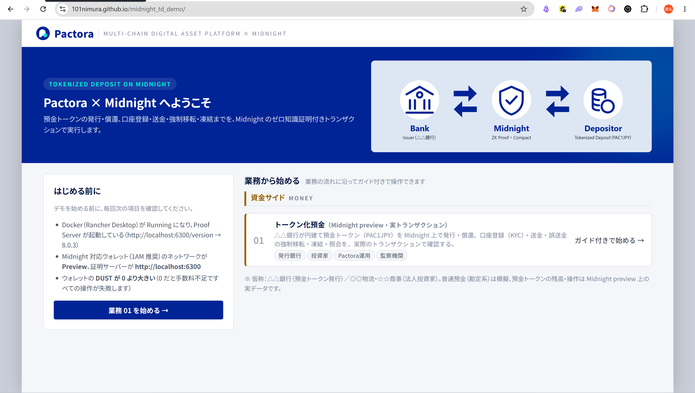
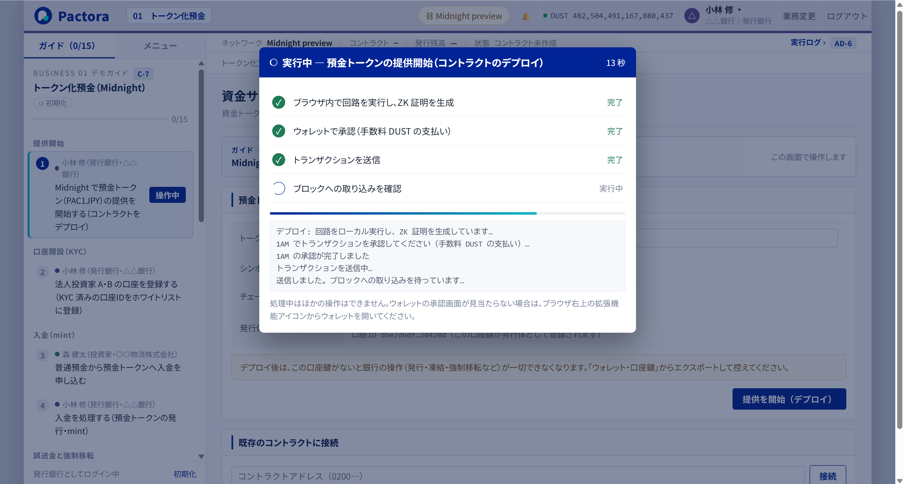
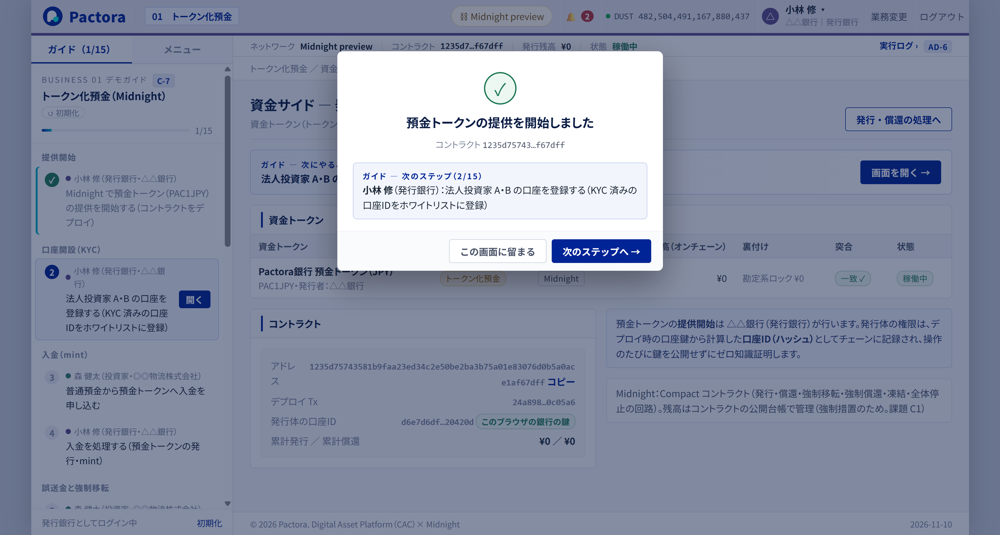
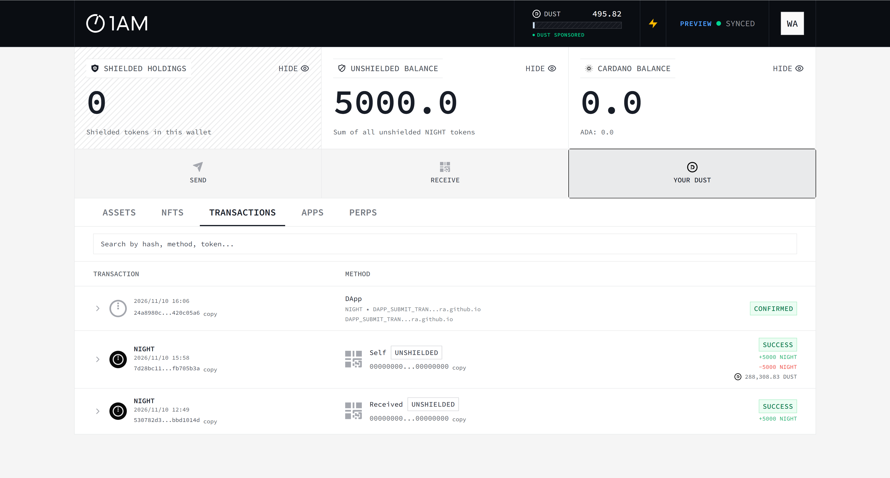

# Midnight 開発環境 構築手順書（Windows 版）

Windows 11 の PC で、Midnight（Preview ネットワーク）上の **Pactora トークン化預金デモ** を動かす環境を作る手順です。
リポジトリ: https://github.com/101nimura/midnight_td_demo ／ 公開中のデモ: **https://101nimura.github.io/midnight_td_demo/**

- 想定する読者: Windows で開発をしている人。ブロックチェーンの経験は不要です
- 所要時間: **デモを動かすだけなら約 30〜60 分**（コース A）。ローカルでビルド・開発する場合は、さらに約 1〜2 時間（コース B）
- 本書は、実際に構築したときのつまずき（2026-11-02 の初版、2026-11-10 の改訂）を踏まえて、**つまずきにくい順序**で書いています。順番どおりに進めてください

> **2026-11-10 改訂のポイント**（初版から大きく変わった点）
>
> | 項目 | 初版（11/2） | 改訂（11/10） | 理由 |
> |---|---|---|---|
> | Preview ネットワーク | ledger 8 のチェーン | **11/7 に ledger 9 の新しいチェーンとして再起動** | 公式の更新。初版で用意した tNIGHT・DUST・コントラクトは消えた（ISSUES.md #35） |
> | ウォレット | Lace | **1AM**（Lace は今の Preview で使えない） | Lace の接続先（Blockfrost）が古いチェーンのまま止まっている（#36） |
> | DUST の用意 | 代替ツール（`dust-designate.cmd`） | **1AM の画面で生成** | ツールは ledger 8 用で使えない（#38） |
> | Proof Server | 8.0.3（必須） | 9.0.0（**1AM を使う場合は不要**） | 1AM はウォレット側で証明を作る |
> | SDK・コンパイラ | midnight-js 4.1.1 / Compact 0.31.1 | **midnight-js 5.0.0 / Compact 0.36.0** | ledger 9 への対応（#37, #38） |
> | デモ | React 版・単一 HTML 版 | **Pactora UI 版**（GitHub Pages / フォルダで配信） | ZK 鍵が約 108MB になり、HTML 1 枚に埋め込めない（#38） |

---

## 0. 全体像

### 0.1 構成

```
 Windows 11
 ├─ Chrome / Edge
 │    ├─ Pactora デモ（https://101nimura.github.io/midnight_td_demo/ または http://localhost:8081）
 │    └─ 1AM ウォレット拡張 ─── 手数料(DUST)の支払い・署名・ZK 証明（ウォレット側で作る）
 │
 ├─ Rancher Desktop（Docker） ………… コース B で必要な場合のみ
 │    └─ Proof Server 9.0.0  http://localhost:6300
 │
 └─ WSL2 (Ubuntu) ………………………… コース B のみ
      ├─ Node.js 24（nvm）        ← デモのビルド・テスト・開発サーバー
      └─ Compact コンパイラ 0.36.0 ← コントラクトを変更したときだけ使う

 Midnight Preview ネットワーク（インターネット）
      ├─ Node (RPC) / Indexer（公式: *.preview.midnight.network） ← デモは状態の読み取りに公式 Indexer を使う
      └─ Faucet（テスト用 tNIGHT の配布）
```

### 0.2 2 つのコース

| コース | 目的 | 必要な章 | 目安 |
|---|---|---|---|
| **A. デモを動かす** | 公開中のデモ（GitHub Pages）を操作する | 1 → 2 → 3 → 4 | 30〜60 分（DUST がたまるのを待つ時間を含む） |
| **B. ローカルでビルド・開発する** | ソースを変更する、社内でデモを配信する、テストを実行する | A に加えて 5 | +1〜2 時間 |

コース A では、**Docker・WSL・Node.js・Git は不要**です。

### 0.3 なぜこの構成なのか（先に知っておくと迷わない点）

| 判断 | 理由 |
|---|---|
| ウォレットは **1AM** | Lace は、Preview の接続先（Blockfrost）がリセット前の古いチェーンのまま止まっていて、残高も取引も正しく扱えない（2026-11-10 時点）。Lace の接続先は利用者も DApp も変更できない |
| デモは状態の読み取りに **公式の Preview Indexer** を使う | ウォレットの接続先が壊れていても、コントラクトの状態を読めるようにするため |
| **バージョンを固定**する（付録 A） | コンパイラ・ランタイム・SDK・Proof Server・ウォレットの組み合わせが厳密に決まっている。公式の対応表（docs.midnight.network の Support matrix）と合わせる |
| ビルドは **WSL2** で行う | Compact コンパイラは Linux / macOS 版のみ。SDK は Node.js 22.12 以上が必要 |
| デモは **フォルダで配信**する | ledger 9 の ZK 証明鍵は約 108MB。HTML 1 枚に埋め込むと GitHub の上限（100MB）を超え、JS だけを埋め込んでも起動しなかった（#38） |

### 0.4 用語

| 用語 | 意味 |
|---|---|
| **Preview** | Midnight の公開テストネット。**予告なくリセット（作り直し）されることがある**。リセットされると tNIGHT・DUST・コントラクトがすべて消える |
| **ledger 8 / ledger 9** | Midnight の台帳の版。2026-11 に 9 へ移行した。版が違う SDK・コンパイラ・Proof Server は使えない |
| **tNIGHT** | Preview 用の NIGHT トークン。Faucet で無料でもらえる |
| **DUST** | 手数料に使うリソース。NIGHT を「DUST 生成」に登録すると、**時間とともに少しずつたまる**。tNIGHT を受け取っただけでは増えない |
| **Proof Server** | ゼロ知識証明を作るサーバー。1AM はウォレット側で証明を作るので、コース A では不要 |
| **unshielded / shielded / DUST アドレス** | Midnight のウォレットには 3 種類のアドレスがある。Faucet の送り先は **unshielded アドレス**（`mn_addr_preview1…`） |
| **口座鍵** | デモの中の登場人物（銀行・利用者 A・B）の秘密鍵。ウォレットの鍵とは別で、**ブラウザに保存**される |

### 0.5 作業の流れ

| 章 | 作業 | コース | 目安 |
|---|---|---|---|
| 1 | 事前確認（ブラウザ・社内ネットワーク・Preview の状態） | A・B | 10 分 |
| 2 | 1AM ウォレット（作成 / インポート、Preview の確認） | A・B | 15 分 |
| 3 | tNIGHT と DUST を用意する | A・B | 10〜30 分 |
| 4 | デモを開いて動作を確認する（デプロイまで） | A・B | 10 分 |
| 5 | ローカル環境（Git・WSL・Node.js・Compact・Docker・ビルド） | B | 1〜2 時間 |
| 6 | 動作確認チェックリスト | A・B | 5 分 |

---

## 1. 事前確認

### 1.1 必要なもの

- Chrome（または Edge）。拡張機能を追加できること
- メモリ 16GB 以上を推奨（ブラウザ内で証明を作るため、メモリを多く使います）
- コース B のみ: Windows 11（WSL2）、**管理者権限**、ディスクの空き 20GB 以上

### 1.2 社内ネットワークの確認

社内のプロキシや **TLS 検査（Netskope / Zscaler など）** がある環境では、Docker コンテナからの HTTPS 通信が失敗します（コース B の 5.5 で対処します）。PowerShell で次を実行し、先に確認しておきます。

```powershell
Get-ChildItem Cert:\LocalMachine\Root | Where-Object { $_.Subject -like '*netskope*' -or $_.Subject -like '*zscaler*' } | Select-Object Subject
```

- 何か表示された → **TLS 検査あり**
- 何も表示されない → TLS 検査なし

> Windows 標準の `curl.exe` は、社内環境で証明書の失効確認に失敗することがあります（`CRYPT_E_NO_REVOCATION_CHECK`）。接続確認では `--ssl-no-revoke` を付けてください。

### 1.3 Preview の状態を確認する（毎回・作業の前に）

Preview はリセットされることがあります（2026-11-07 に実際にリセットされました）。**以前に用意した tNIGHT・DUST・コントラクトが使えるか**を、作業の前に確認します。PowerShell で次を実行します。

```powershell
curl.exe -sS --ssl-no-revoke -H "Content-Type: application/json" -d '{\"query\":\"{ block { height timestamp } }\"}' https://indexer.preview.midnight.network/api/v4/graphql
```

- `{"data":{"block":{"height":…}}}` が返れば Preview は動いています
- **前回より `height`（ブロック高）が小さくなっていたら、リセットされています**。tNIGHT と DUST を取り直し（3 章）、デモは「新しいコントラクトで最初から」始めます（4.4）
- 最新の情報は公式ドキュメント（https://docs.midnight.network/guides/networks-and-environments ）で確認します

---

## 2. 1AM ウォレット

### 2.1 インストール

1. https://1am.xyz/ を開き、**Chrome の拡張機能**を追加します（Firefox 版・スマートフォン版もありますが、デモには Chrome 版を使います）
2. ブラウザ右上の拡張機能アイコン（パズルのマーク）から 1AM を**固定**しておくと、承認画面を開きやすくなります

> **Lace について**: Lace（Midnight 対応版）も DApp に接続できますが、2026-11-10 時点では Preview の接続先（Blockfrost）がリセット前の古いチェーンのまま止まっていて、使えません（7 章「Lace で `Internal Server Error`」）。Lace と 1AM の両方が入っている場合、デモは **1AM を優先して**接続します。

### 2.2 ウォレットを用意する（新規作成 または インポート）

**A. 新しく作る場合（推奨）**

1. 1AM を開き、ウォレットの作成を選びます
2. **リカバリーフレーズ**が表示されるので、**紙に書き写して安全な場所に保管**します
   - スクリーンショットやクラウドへの保存はしないでください
   - デモ・検証専用のウォレットにして、本番の資産とは分けてください
3. 確認の入力をして、1AM を開くときのパスワードを決めます

**B. 既存のウォレットをインポートする場合**

1. 1AM を開き、ウォレットの復元（リカバリーフレーズで復元）を選びます
2. 保管してあるリカバリーフレーズを入力し、パスワードを決めます
3. 同期が終わるまで待ちます

> ほかの人の PC にインポートする場合も、リカバリーフレーズを口頭やチャットで伝えないでください。デモ用でも、新しく作る（A）ことを推奨します。

### 2.3 Preview を選んで同期を確認する

1. 1AM の右上のアカウント（`WA` など）を押し、メニューの上部が **`PREVIEW`** になっていることを確認します。違う場合は「CHANGE」で Preview に切り替えます
2. 画面右上に **`PREVIEW ● SYNCED`** と表示されれば、同期できています


### 2.4 アドレスを確認する

| アドレス | 形式 | 使い道 | 確認方法 |
|---|---|---|---|
| **unshielded** | `mn_addr_preview1…` | Faucet から tNIGHT を受け取る | 1AM のホームで **RECEIVE** を押す |
| shielded | `mn_shield-addr_preview1…` | 秘匿トークンの受け取り | RECEIVE の画面で切り替える |
| DUST | `mn_dust_preview1…` | DUST の受け取り先 | デモの右上「ウォレット」の画面にも表示される |

デモでは、銀行と利用者を**デモの中の口座鍵**で切り替えます。ウォレットのアカウントは 1 つで足ります。

---

## 3. tNIGHT と DUST を用意する

> **重要: DUST が 0 だと、デプロイを含むすべての操作が手数料不足で失敗します。**
> tNIGHT を受け取っただけでは DUST は増えません。「DUST 生成の登録」が別に必要で、登録後も**時間とともに少しずつ**たまります。

### 3.1 tNIGHT を受け取る

1. 1AM の **RECEIVE** で unshielded アドレス（`mn_addr_preview1…`）をコピーします
2. **ブラウザで** Preview の公式 Faucet を開きます: **https://faucet.preview.midnight.network/**
3. アドレスを貼り付けて請求します
4. 数分後、1AM の **UNSHIELDED BALANCE** に **5000.0** と表示され、TRANSACTIONS に `Received … +5000 NIGHT` が出ます


> Faucet には API もありますが、初版の構築時には「OK」が返っても実際には届かないことがありました。**ブラウザの画面から請求する**のが確実です。

### 3.2 DUST を生成する（1AM の画面から）

1. 1AM のホームで **YOUR DUST** を押します
2. 「DUST GENERATION」の欄で **GENERATE DUST** を押し、承認します
   - 受け取った NIGHT（unshielded の UTXO）を DUST 生成に登録するトランザクションです
   - 「DESIGNATED DUST ADDRESS (OPTIONAL)」は空欄のままで構いません（自分のウォレットに DUST がたまります）
3. 登録が終わると、TRANSACTIONS に `Self … UNSHIELDED +5000 NIGHT / −5000 NIGHT` のような行が出ます
4. YOUR DUST の画面で、**Available Balance** が増えていくことを確認します（構築時は約 0.04 DUST/秒。登録から数分で数百 DUST になりました）


5. 画面右上の **DUST** が 0 より大きくなれば準備完了です

| 表示 | 意味 |
|---|---|
| NIGHT UTXOS AVAILABLE: 0 | 登録できる NIGHT がもうない（登録済み）。DUST がたまるのを待つ |
| Pending Maturity | これから使えるようになる DUST |
| DUST GENERATION: +0.04 DUST/s | DUST がたまる速さ |

> **初版の代替ツール（`dust-install.cmd` / `dust-designate.cmd`）は使えません。** ledger 8 用のまま（testkit-js 4.x）のためです（ISSUES.md #38）。

---

## 4. デモを開いて動作を確認する

### 4.1 デモを開く

Chrome で **https://101nimura.github.io/midnight_td_demo/** を開きます（コース B でローカルに配信する場合は 5.7）。



> - 初回は、JS・WASM（約 26MB）の読み込みに十数秒かかります
> - 起動に失敗したときは、画面に「デモの起動に失敗しました」とエラーが表示されます（真っ白のままにはなりません）
> - ファイルを直接開く（`file://`）方法は使えません。ウォレットが組み込まれないためです（ISSUES.md #33）

### 4.2 ウォレットに接続する（S-2）

1. 「業務 01 を始める」を押します
2. S-2 で **「ウォレットに接続」** を押し、1AM の承認画面で接続を許可します
3. 次の表示になることを確認します

| 項目 | 期待する表示 |
|---|---|
| ウォレット（Midnight）に接続 | 接続済み（`1AM ／ network=preview ／ 証明：1AM に委譲`） |
| 手数料（DUST）の確認 | OK（DUST が 0 なら 3.2 に戻る） |
| Proof Server の起動確認 | 1AM を使う場合は「停止中」でも構いません（ウォレット側で証明するため） |
| デモユーザーの口座鍵 | 作成済み（銀行・◎◎物流・☆☆商事の口座ID） |
| コントラクト | 初回は「ログイン後に作成」 |

4. 「ログイン画面へ」を押します

### 4.3 デプロイ（提供開始）を確認する

1. ログイン画面で、ユーザー一覧から **小林 修（△△銀行）** の「ログイン」を押します
2. 左のガイドのステップ 1 が「操作中」になり、「資金トークン 一覧（M-1）」が開きます。**「提供を開始（デプロイ）」** を押します
3. 確認画面で「承認して実行」を押すと、**1AM の承認画面**が開くので承認します



4. 1〜数分で「預金トークンの提供を開始しました」と表示されれば成功です。画面上部の「状態」が **稼働中** になります



5. **右上の「ウォレット・口座鍵」→「口座鍵のエクスポート」で、口座鍵を控えておきます。** 銀行の口座鍵がないと、別のブラウザや別の URL から銀行の操作ができません
6. 1AM の TRANSACTIONS に、デモからのトランザクション（`DApp … github.io`、`CONFIRMED`）が表示されます



以降は、左のガイドに沿ってステップ 2〜15 を進めます（README の 3.3）。

### 4.4 2 回目以降・別の環境で使うとき

| 状況 | 操作 |
|---|---|
| 同じブラウザ・同じ URL で続きをする | そのまま開く（口座鍵とコントラクトはブラウザに保存されている） |
| 別のブラウザ・別の URL（GitHub Pages と localhost など）で続きをする | S-2 で「口座鍵のインポート」と「既存のアドレスを指定」を行う |
| Preview がリセットされた（1.3） | 左下の「初期化」→ **「新しいコントラクトで最初から」** を選び、デプロイからやり直す |

---

## 5. ローカル環境（コース B）

### 5.1 Git のインストールとリポジトリのクローン

**① Git for Windows**（`git --version` でバージョンが表示されれば不要）: https://git-scm.com/download/win からインストールします。設定はすべて既定のままで構いません。

**② クローンする**: 置き場所は、**空白や日本語を含まず、OneDrive で同期されていないフォルダ**にします（例: `C:\work`）。

```powershell
mkdir C:\work -Force
cd C:\work
git clone https://github.com/101nimura/midnight_td_demo.git
cd midnight_td_demo
```

本書では、このフォルダを **「リポジトリのフォルダ」** と呼びます。PowerShell のコマンドは、特に断りがなければここで実行します。

> - ダウンロードには、コンパイル済みのコントラクト（ZK 証明鍵 約 108MB）が含まれます。数分かかります
> - スクリプト（`*.cmd`）は自分の置き場所を基準に動くので、どのフォルダにクローンしても書き換えは不要です
> - `*.sh` の改行は `.gitattributes` で LF に固定しています。WSL で `$'\r': command not found` と出たら、`git rm --cached -r .` → `git reset --hard` を実行してください

| 区分 | 内容 | 用意の仕方 |
|---|---|---|
| 含まれる | コントラクト（**コンパイル済み**、ZK 証明鍵・マニフェストを含む）、デモのソース、スクリプト、ドキュメント | クローンするだけ |
| 含まれない | `node_modules/`（依存パッケージ） | `npm-install.cmd`（5.7） |
| 含まれない | `dist-pactora/`（ビルド結果） | `build-pactora.cmd`（5.7） |
| 含まれない | `certs/`（Proof Server 用の CA バンドル） | `make-ca-bundle.cmd`（5.6） |

### 5.2 `.cmd` は PowerShell かエクスプローラーから実行する

リポジトリの `*.cmd` は **Windows のバッチファイル**です。

| 実行する場所 | 書き方 | 結果 |
|---|---|---|
| PowerShell | `.\build-pactora.cmd` | ○ |
| エクスプローラー | ダブルクリック | ○ |
| **WSL の bash**（`user@PC:/mnt/c/...$`） | `.\build-pactora.cmd` | ✕ `command not found`（11/10 に実際に発生） |
| Git Bash | `wsl ...` を直接書く場合 | パスが書き換えられて失敗する。`MSYS_NO_PATHCONV=1` を付ける |

WSL の bash の中で実行したい場合は、`.cmd` の中身と同じコマンド（例: `bash .tools/npm.sh run build:pactora`）を使います。

### 5.3 WSL2 と Ubuntu

管理者の PowerShell で実行し、再起動を求められたら再起動します。初回の起動時に、Ubuntu のユーザー名とパスワードを決めます。

```powershell
wsl --install -d Ubuntu
wsl -l -v      # Ubuntu が VERSION 2 で表示されれば OK
```

> スクリプトは、ディストリビューション名を `Ubuntu` として動きます。別の名前（例: `Ubuntu-24.04`）の場合は、`[Environment]::SetEnvironmentVariable('WSL_DISTRO','Ubuntu-24.04','User')` を実行し、PowerShell を開き直してください。

### 5.4 Node.js（WSL 内）

```powershell
wsl -d Ubuntu
```

以降、`$` で始まる行は Ubuntu の中で実行します。

```bash
$ curl -fsSL https://raw.githubusercontent.com/nvm-sh/nvm/v0.40.3/install.sh | bash
$ source ~/.bashrc
$ nvm install 24
$ node -v      # v24.x（22.12 以上なら可）と表示されれば OK
```

> Windows 側の Node.js は使いません。WSL に引き継がれる Windows の PATH の影響を避けるため、スクリプトは `.tools/env.sh` で PATH を設定し直してから実行します。

### 5.5 Compact コンパイラ（WSL 内・コントラクトを変更する場合のみ）

コンパイル済みのコントラクトがリポジトリに入っているので、**`contract/tdeposit.compact` を変更しないなら不要**です。

```bash
$ curl --proto '=https' --tlsv1.2 -LsSf https://github.com/midnightntwrk/compact/releases/latest/download/compact-installer.sh | sh
$ source ~/.bashrc
$ compact update 0.36.0     # ★必ずこのバージョンに固定する
$ compact compile --version # 0.36.0 と表示されれば OK
```

コンパイルは `.\compile-contract.cmd`（PowerShell）で行います。ZK 鍵の生成込みで数分かかります。

> - **バージョンは対応表に合わせること。** midnight-js 5.0.0 が受け付けるのはランタイム 0.21（コンパイラ 0.36.0）と 0.16（0.31.1）だけです。0.33〜0.35 の出力は `EraMismatchError` で拒否されます
> - **Windows の `compact.exe` と混同しないこと。** Windows には NTFS の圧縮ツール `C:\Windows\System32\compact.exe` があります。Compact コンパイラは必ず WSL の中で実行します

### 5.6 Rancher Desktop と Proof Server（必要な場合のみ）

**1AM を使うなら Proof Server は不要です**（11/10 のデプロイでは、Proof Server に証明の依頼は届きませんでした）。次の場合だけ用意します。

- 証明をローカルの Proof Server で作りたい（`.env` に `VITE_PROOF_SERVER=http://localhost:6300` を設定する場合）
- 証明サーバーを「カスタム `http://localhost:6300`」に設定したウォレットを使う

**① Rancher Desktop**

1. https://rancherdesktop.io/ から Windows 版をインストールします（管理者権限が必要です）
2. 初回の設定: **Container Engine は `dockerd (moby)`**（containerd では `docker` コマンドが使えません）。Kubernetes は不要なら OFF
3. **画面下部の表示が「Running」になるまで待ちます**。起動しきる前に `docker` を使うと `//./pipe/docker_engine` のエラーになります
4. PowerShell で `docker info` を実行し、`Server Version: ...` が表示されれば OK です

**② CA バンドルを作る（初回のみ・全員）**

Proof Server は起動時に、証明用のパラメータを **Amazon S3 からダウンロード**します。社内に TLS 検査があると、ダウンロードに失敗して停止します。`proof-server.yml` が必ず読み込むので、TLS 検査の有無にかかわらず作ります。

```powershell
.\make-ca-bundle.cmd     # certs\ca-bundle.crt ができれば OK
```

（Zscaler など Netskope 以外の製品の場合は `.tools\make-ca-bundle.ps1 -Pattern '*zscaler*'`）

**③ 起動**

```powershell
docker compose -f proof-server.yml up -d
docker compose -f proof-server.yml logs -f     # 確認したら Ctrl+C で抜ける
```

- 初回（またはバージョンの変更後）は、イメージとパラメータのダウンロードで数分かかります。ログに `listening on: 0.0.0.0:6300` が出れば起動完了です
- ブラウザで http://localhost:6300/version を開き、**`9.0.0`** と表示されれば OK です
- PC を再起動したあとは、**Rancher Desktop が Running になってから** `up -d` を実行します

### 5.7 依存パッケージ・テスト・ビルド・起動

```powershell
.\npm-install.cmd        # 依存パッケージ（数分）
.\run-tests.cmd          # 「9 passed」と出れば OK（ネットワーク不要のシミュレータテスト）
.\build-pactora.cmd      # dist-pactora\ にビルド（HTML + assets\ + keys\ zkir\ compiler\）
.\start-pactora.cmd      # http://localhost:8081/pactora-tdeposit-demo.html で配信
```

| 方法 | URL | 用途 |
|---|---|---|
| `start-pactora.cmd` | http://localhost:8081/pactora-tdeposit-demo.html | ビルドした版を社内・手元で配信する |
| `start-dev.cmd` | http://localhost:5173/pactora.html | ソースを変更しながら確認する（開発サーバー） |
| GitHub Pages | https://101nimura.github.io/midnight_td_demo/ | main に push すると GitHub Actions がビルドして自動で公開する |

> - `dist-pactora\` は**フォルダごと**配信します（HTML だけをコピーしても動きません）
> - 開いた URL ごとに、ブラウザの保存領域（口座鍵・コントラクトのアドレス）は別になります（4.4）
> - 開発サーバーで `Port 5173 is already in use` が出たら、すでに別のサーバーが起動しています

---

## 6. 動作確認チェックリスト

| # | コース | 確認項目 | 期待する結果 |
|---|---|---|---|
| 1 | A・B | 1.3 の Preview の確認 | `height` が返る（前回より小さければリセット済み） |
| 2 | A・B | 1AM の右上 | `PREVIEW ● SYNCED` |
| 3 | A・B | 1AM の DUST | 0 より大きい |
| 4 | A・B | デモの S-2 | ウォレットが接続済み、DUST が OK |
| 5 | A・B | デモのステップ 1（デプロイ） | 「預金トークンの提供を開始しました」、状態が「稼働中」 |
| 6 | B | `run-tests.cmd` | 9 passed |
| 7 | B | `build-pactora.cmd` → `start-pactora.cmd` | http://localhost:8081/pactora-tdeposit-demo.html に S-1 が表示される |
| 8 | B（Proof Server を使う場合） | http://localhost:6300/version | 9.0.0 |

ここまでできれば、README の「3.3 Pactora UI 版」のガイドに沿ってデモを進められます。

---

## 7. トラブルシューティング（まとめ）

**ウォレット・ネットワーク**

| 症状 | 原因 | 対処 |
|---|---|---|
| 「Midnight 対応のウォレット（1AM / Lace）が見つかりません。file:// で開いています」 | `file://` で開くと、許可設定を ON にしてもウォレットが組み込まれない（#33） | GitHub Pages か `start-pactora.cmd`（http://localhost:8081）で開く |
| 「…見つかりません。window.midnight がありません」 | 拡張機能が無効 / サイトへのアクセスが制限されている | 拡張機能の「詳細」→「サイトへのアクセス」を「すべてのサイト」にして再読み込み |
| Lace で、デプロイが `balanceUnsealedTransaction … Internal Server Error` で失敗する | Lace の接続先（Blockfrost）がリセット前のチェーンのままで、インデクサが 500 を返す（#36）。Lace の設定では変更できない | **1AM を使う**。Lace と 1AM の両方が入っていれば、デモは 1AM を優先する |
| Lace に、リセット前の DUST・NIGHT が表示され続ける／Faucet の tNIGHT が表示されない | 同上（Lace が古いチェーンを見ている）。再同期しても直らない | 1AM を使う |
| `[InternalError] No account is connected for this dApp. Please reconnect.` | ウォレットの設定を変えた・ロックした・アカウントを切り替えたため、DApp との接続が切れた | もう一度操作すると接続し直す（承認画面が開く）。直らなければページを再読み込み |
| 「ウォレットのネットワーク (…) が preview ではありません」 | ウォレットのネットワークが違う | 1AM のメニューで PREVIEW に切り替える（2.3） |
| Faucet が成功と表示されたのに着金しない | 送り先のアドレス違い / ウォレットが同期していない | unshielded アドレス（`mn_addr_preview1…`）に送ったか確認。`SYNCED` になるまで待つ |
| 以前のコントラクトのアドレスが表示される・操作できない | Preview がリセットされた（#35） | 左下の「初期化」→「新しいコントラクトで最初から」 |

**DUST・手数料**

| 症状 | 原因 | 対処 |
|---|---|---|
| DUST がずっと 0 | DUST 生成を登録していない / 登録直後 | 3.2 の GENERATE DUST。登録後に数分待つ |
| `dust-designate.cmd` が使えない | 初版の代替ツールは ledger 8 用（#38） | 1AM の画面で DUST を生成する（3.2） |

**デモ・ビルド**

| 症状 | 原因 | 対処 |
|---|---|---|
| 「デモの起動に失敗しました」が表示される | 読み込みの失敗 / 古いキャッシュ | Ctrl+Shift+R で再読み込み。表示されたエラーと F12 のコンソールを確認 |
| デモの表示が古い（Proof Server が 8.0.3 と書かれている など） | ブラウザのキャッシュ / GitHub Pages の更新待ち | 数分待ってから Ctrl+Shift+R |
| `.\xxx.cmd: command not found` | WSL の bash で `.cmd` を実行した | PowerShell かエクスプローラーから実行する（5.2） |
| WSL のコマンドで `C:/Program Files/Git/mnt/c/... No such file` | Git Bash がパスを書き換えている | PowerShell で実行する。または `MSYS_NO_PATHCONV=1` を付ける |
| `EraMismatchError` / `checkRuntimeVersion` のエラー | Compact のバージョン違い | `compact update 0.36.0` → `compile-contract.cmd` |
| `compact` で NTFS 圧縮の結果のような出力が出る | Windows の `compact.exe` が動いている | WSL の中で実行する |

**Proof Server（使う場合）**

| 症状 | 原因 | 対処 |
|---|---|---|
| `//./pipe/docker_engine` のエラー | Rancher Desktop が起動しきっていない | Running になるまで待つ |
| Proof Server がすぐ止まる（S3 からのダウンロードに失敗） | 社内の TLS 検査 | 5.6 の CA バンドルを作ってから起動し直す |
| http://localhost:6300/version が 8.0.3 のまま | 古いイメージのコンテナが動いている | `docker compose -f proof-server.yml up -d` で 9.0.0 に入れ替える |

---

## 付録 A. バージョン一覧（2026-11-10 に動作を確認した組み合わせ）

公式の対応表（Preview / ledger 9）に合わせています。

| コンポーネント | バージョン |
|---|---|
| Midnight Preview | ledger 9（2026-11-07 に再起動）、Node 2.1.101、Indexer 4.4.101 |
| ウォレット | 1AM（Chrome 拡張、DApp Connector API v4） |
| Compact コンパイラ | 0.36.0（言語 0.28） |
| @midnight-ntwrk/compact-runtime | 0.21.0 |
| midnight-js 各パッケージ | 5.0.0 |
| @midnightntwrk/dapp-connector-api | 4.1.0 |
| @midnightntwrk/ledger-v9 | 1.0.0 |
| Proof Server（Docker イメージ） | midnightntwrk/proof-server:9.0.0（必要な場合のみ） |
| Node.js（WSL） | 24.x（22.12 以上） |
| Vite | 8.x |

> 初版（2026-11-02、ledger 8）は Compact 0.31.1 / compact-runtime 0.16.0 / midnight-js 4.1.1 / DApp Connector API 4.0.1 / Proof Server 8.0.3 でした。今の Preview では使えません。

## 付録 B. 接続先（Preview）

| 用途 | URL |
|---|---|
| Indexer（GraphQL） | https://indexer.preview.midnight.network/api/v4/graphql |
| Indexer（WebSocket） | wss://indexer.preview.midnight.network/api/v4/graphql/ws |
| Node（RPC） | https://rpc.preview.midnight.network |
| **公式 Faucet（ブラウザで使う）** | **https://faucet.preview.midnight.network/** |
| Proof Server（ローカル・必要な場合のみ） | http://localhost:6300 |
| デモ（GitHub Pages） | https://101nimura.github.io/midnight_td_demo/ |
| リポジトリ | https://github.com/101nimura/midnight_td_demo |
| 公式ドキュメント（ネットワーク・対応表） | https://docs.midnight.network/guides/networks-and-environments |

- デモは、チェーンの状態の読み取りに上の公式 Indexer を使います。手数料の支払いと送信、ZK 証明はウォレット（1AM）に任せます
- Lace の Preview の接続先は Blockfrost（`rpc.midnight-preview.blockfrost.io` / `midnight-preview.blockfrost.io`）で、利用者は変更できません（2026-11-10 時点で古いチェーンのまま）


## 付録 C. 改訂履歴

| 日付 | 内容 |
|---|---|
| 2026-11-02 | 初版（ledger 8、Lace、React 版・単一 HTML 版、DUST 代替ツール） |
| 2026-11-10 | Preview の再起動（ledger 9）に対応。ウォレットを 1AM に、デモを Pactora UI 版（GitHub Pages）に変更。DUST は 1AM で生成。コース A（デモを動かすだけ）を追加。今日のつまずき（file://、Lace の接続先、接続切れ、`.cmd` の実行場所、Preview のリセット）をトラブルシューティングに追加 |
