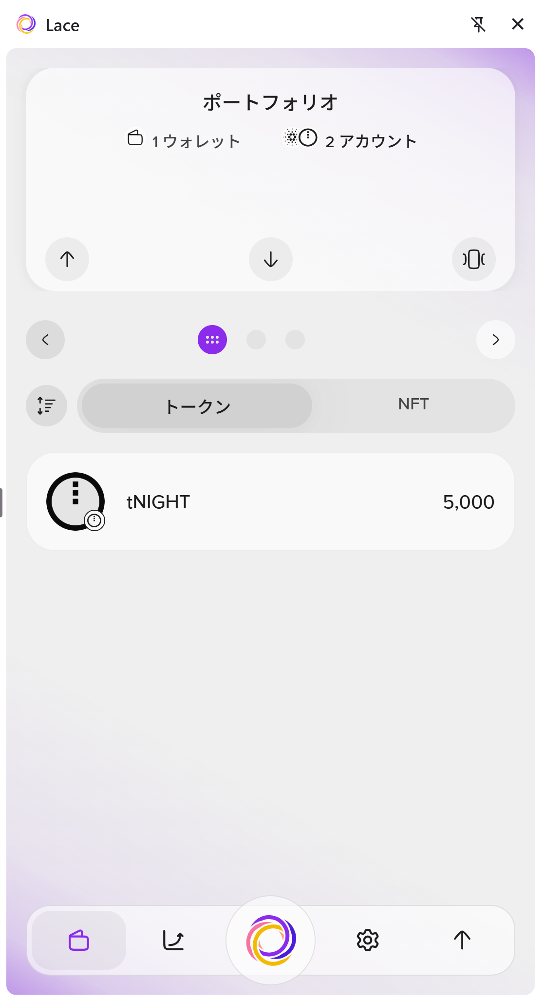
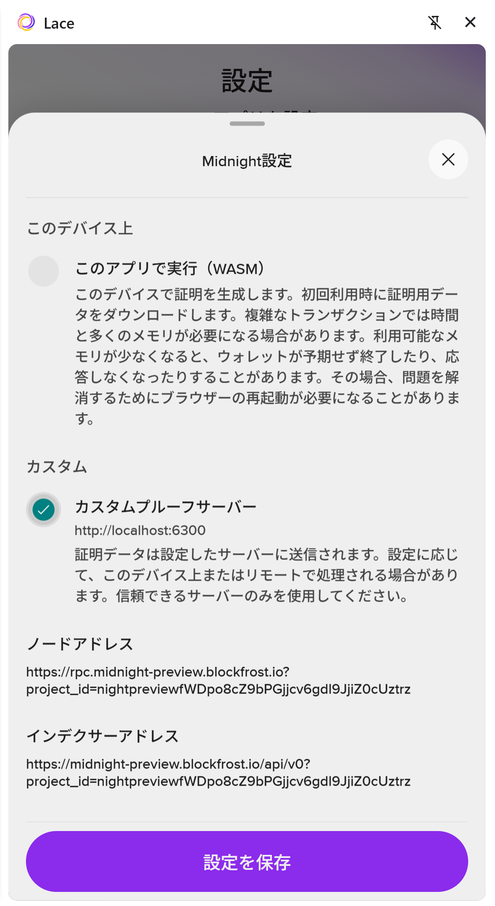
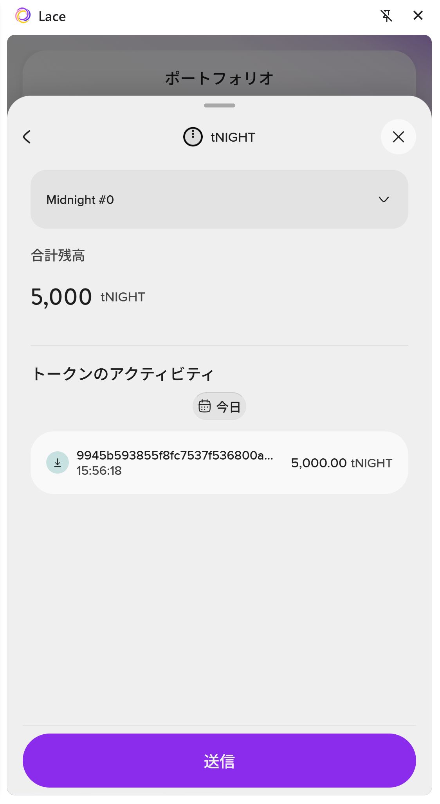
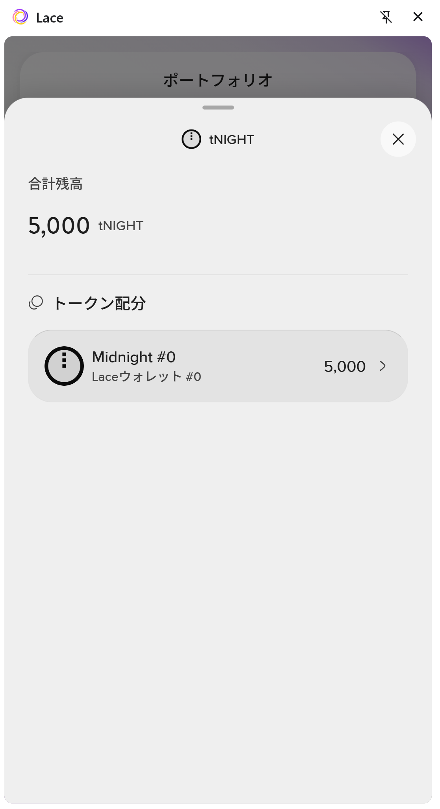
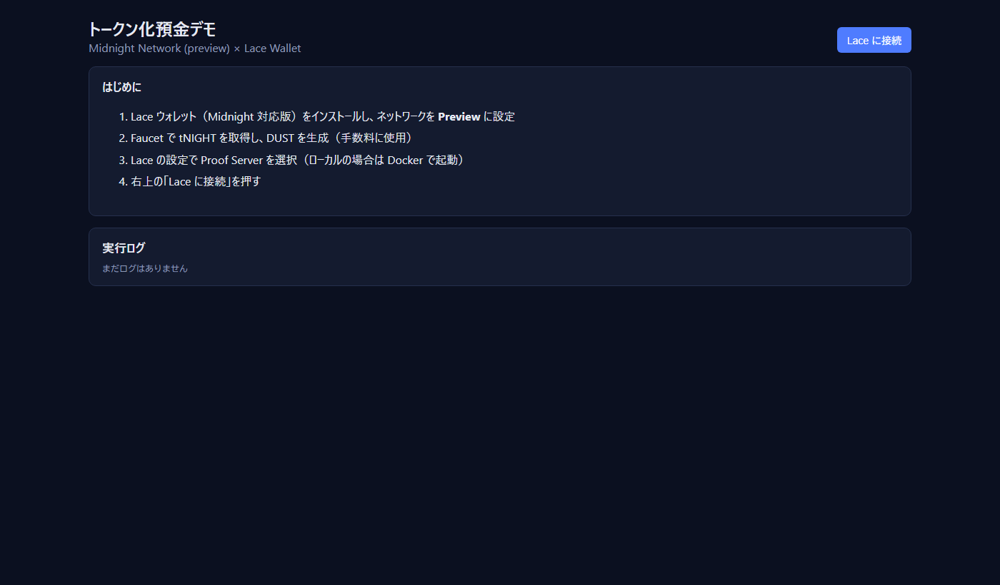
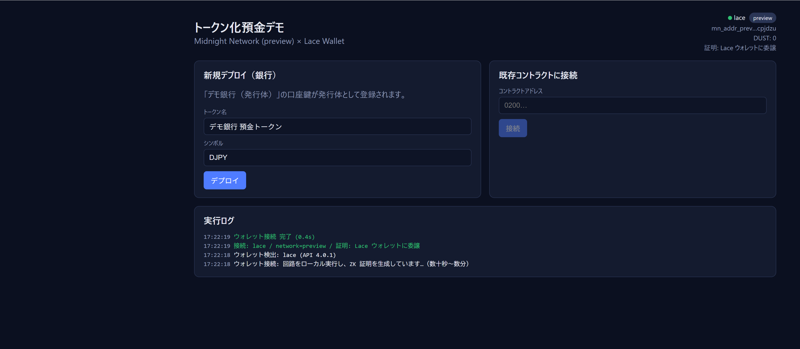

# Midnight 開発環境 構築手順書（Windows 版）

Windows 11 の PC で Midnight（Preview ネットワーク）の DApp を開発・実行する環境を、一から作る手順です。
本プロジェクト（トークン化預金デモ）を動かすところまでを扱います。

- 想定する読者: Windows で開発をしている人。ブロックチェーンの経験は不要です
- 所要時間: 約 2〜3 時間（ダウンロードと同期の待ち時間を含みます）
- 本書は実際に構築したときのつまずきを踏まえて、**つまずきにくい順序**で書いています。順番どおりに進めてください

---

## 0. 全体像

### 0.1 構成

```
 Windows 11
 ├─ Chrome / Edge
 │    ├─ デモアプリ（http://localhost:5173 または 単一 HTML）
 │    └─ Lace ウォレット拡張 ─────┐ 署名・手数料(DUST)・証明の依頼
 │                                 ▼
 ├─ Rancher Desktop（Docker）
 │    └─ Proof Server  http://localhost:6300   ← ZK 証明を作る
 │
 └─ WSL2 (Ubuntu)
      ├─ Node.js 24（nvm）       ← アプリのビルド・開発サーバー
      └─ Compact コンパイラ 0.31.1 ← コントラクトのコンパイル

 Midnight Preview ネットワーク（インターネット）
      ├─ Node (RPC) / Indexer
      └─ Faucet（テスト用 tNIGHT の配布）
```

### 0.2 なぜこの構成なのか（先に知っておくと迷わない点）

| 判断 | 理由 |
|---|---|
| ビルドを **WSL2** で行う | Compact コンパイラは Linux / macOS 版しかありません。また Midnight の SDK は Node.js 22 以上（公式サンプルは 24）が必要で、Windows 側に古い Node が入っていても影響を受けないように分けます |
| Docker は **Rancher Desktop** | Proof Server は Docker イメージで提供されています（Docker Desktop でも構いません） |
| Compact は **0.31.1 に固定** | 最新版（0.35）は、まだ RC 版の新しいランタイム向けのコードを出力し、Preview で使う安定版 SDK（midnight-js 4.1.1）と組み合わせられません |
| Proof Server は **8.0.3** | ledger v8 系の SDK と合わせます。バージョンがずれると証明が通りません |

### 0.3 用語

| 用語 | 意味 |
|---|---|
| **tNIGHT** | Preview 用の NIGHT トークン。Faucet で無料でもらえる |
| **DUST** | 手数料に使うリソース。NIGHT を「DUST 生成」に登録すると、**時間とともに少しずつたまる**。tNIGHT を受け取っただけでは増えない |
| **Proof Server** | トランザクションのゼロ知識証明を作るサーバー。手元の Docker で動かす |
| **unshielded / shielded / DUST アドレス** | Midnight のウォレットには 3 種類のアドレスがある。Faucet の送り先は **unshielded アドレス**（`mn_addr_preview1…`）、DUST の受け取り先は **DUST アドレス**（`mn_dust_preview1…`） |

### 0.4 作業の流れ

| 章 | 作業 | 目安 |
|---|---|---|
| 1 | 事前確認（権限・ネットワーク） | 10 分 |
| 2 | WSL2 と Ubuntu | 20 分 |
| 3 | Node.js（WSL 内） | 10 分 |
| 4 | Compact コンパイラ（WSL 内） | 10 分 |
| 5 | Rancher Desktop と Proof Server | 30 分 |
| 6 | Lace ウォレット（作成 / インポート、アドレスの確認） | 20 分 |
| 7 | tNIGHT と DUST を用意する | 20〜60 分 |
| 8 | プロジェクトのセットアップと起動 | 20 分 |
| 9 | 動作確認 | 10 分 |

---

## 1. 事前確認

### 1.1 必要なもの

- Windows 11（WSL2 が使えること）
- **管理者権限**（WSL と Rancher Desktop のインストールで必要）
- メモリ 16GB 以上を推奨（Proof Server とブラウザ内の証明処理はメモリを多く使います）
- ディスクの空き 20GB 以上
- Chrome または Edge

### 1.2 社内ネットワークの確認（重要）

社内のプロキシや **TLS 検査（Netskope / Zscaler など）** がある環境では、Docker コンテナからの HTTPS 通信が失敗します。後の 5.3 で対処するので、先に該当するかどうかを確認しておきます。

PowerShell で次を実行します。

```powershell
Get-ChildItem Cert:\LocalMachine\Root | Where-Object { $_.Subject -like '*netskope*' -or $_.Subject -like '*zscaler*' } | Select-Object Subject
```

- 何か表示された → **TLS 検査あり**。5.3 の作業が必要です
- 何も表示されない → 5.3 は不要です

> Windows 標準の `curl.exe` は、社内環境で証明書の失効確認に失敗することがあります（`CRYPT_E_NO_REVOCATION_CHECK`）。接続確認で使う場合は `--ssl-no-revoke` を付けてください。

### 1.3 PowerShell と Git Bash の違い

本書のコマンドは **PowerShell** で実行する前提です。Git Bash から `wsl` を実行すると、パスが勝手に書き換えられて失敗します（`/mnt/c/...` が `C:/Program Files/Git/mnt/c/...` になる）。Git Bash を使う場合は、コマンドの先頭に `MSYS_NO_PATHCONV=1` を付けてください。

---

## 2. WSL2 と Ubuntu

### 2.1 インストール

管理者の PowerShell で実行します。

```powershell
wsl --install -d Ubuntu-24.04
```

再起動を求められたら再起動します。初回の起動時に、Ubuntu のユーザー名とパスワードを決めます。

### 2.2 確認

```powershell
wsl -l -v
```

`Ubuntu-24.04`（または `Ubuntu`）が `VERSION 2` で表示されれば OK です。

> 本書では、ディストリビューション名を `Ubuntu` として書いています。名前が違う場合は、`wsl -d <名前>` の部分を読み替えてください。

---

## 3. Node.js（WSL 内）

WSL の Ubuntu に入ってから作業します。

```powershell
wsl -d Ubuntu
```

以降、`$` で始まる行は Ubuntu の中で実行します。

```bash
$ curl -fsSL https://raw.githubusercontent.com/nvm-sh/nvm/v0.40.3/install.sh | bash
$ source ~/.bashrc
$ nvm install 24
$ node -v      # v24.x と表示されれば OK
```

> Windows 側の Node.js（`C:\Program Files\nodejs`）は使いません。古いままでも問題ありません。
> Windows の PATH には空白を含むフォルダがあり、WSL へ引き継がれたときに PATH の設定がおかしくなる場合があります。本プロジェクトでは `.tools/env.sh` で PATH を設定し直してから各コマンドを実行するようにしています。

---

## 4. Compact コンパイラ（WSL 内）

```bash
$ curl --proto '=https' --tlsv1.2 -LsSf https://github.com/midnightntwrk/compact/releases/latest/download/compact-installer.sh | sh
$ source ~/.bashrc          # または export PATH="$HOME/.local/bin:$PATH"
$ compact update 0.31.1     # ★必ずこのバージョンに固定する
$ compact compile --version # 0.31.1 と表示されれば OK
```

> **注意 1: 最新版を使わないこと**
> `compact update` だけを実行すると最新版（0.35 など）が入ります。最新版が出力するコードは `compact-runtime 0.20` 向けで、安定版の midnight-js 4.1.1（`compact-runtime 0.16`）では「ランタイムのバージョンが違う」というエラーで動きません。
>
> **注意 2: Windows の `compact.exe` と混同しないこと**
> Windows には NTFS の圧縮ツール `C:\Windows\System32\compact.exe` という同じ名前のコマンドがあります。PowerShell で `compact` を実行するとこちらが動きます。Compact コンパイラは**必ず WSL の中で**実行してください。

---

## 5. Rancher Desktop と Proof Server

### 5.1 Rancher Desktop のインストール

1. https://rancherdesktop.io/ から Windows 版をダウンロードしてインストールします（管理者権限が必要です）
2. 初回の起動時の設定:
   - **Container Engine: `dockerd (moby)`**（containerd を選ぶと `docker` コマンドが使えません）
   - Kubernetes: 不要なら OFF。ON のままだと起動に数分余計にかかります
3. **画面下部の表示が「Running」になるまで待ちます**

> 起動しきる前に `docker` を実行すると、次のエラーになります。故障ではないので、待ってからやり直してください。
> `error during connect: ... open //./pipe/docker_engine: The system cannot find the file specified.`

確認:

```powershell
docker info
```

サーバー情報（`Server Version: ...`）が表示されれば OK です。

### 5.2 プロジェクトフォルダを置く

本プロジェクトのフォルダを `C:\Users\<ユーザー名>\midnight_demo` に置きます（共有フォルダや Git から取得します）。

> スクリプトの多くは `C:\Users\ynimura\midnight_demo` を前提に書かれています。ユーザー名やフォルダの場所が違う場合は、`*.cmd` と `.tools/*.sh` の中のパスを置き換えてください。

### 5.3 TLS 検査がある環境の準備（1.2 で該当した場合のみ）

Proof Server は起動時に、証明用のパラメータを **Amazon S3 からダウンロード**します。TLS 検査の証明書をコンテナが信頼していないと、ダウンロードに失敗して停止します。

失敗したときのログ:
```
WARN midnight_base_crypto::data_provider: error sending request for url (https://midnight-s3-fileshare-dev-eu-west-1.s3...)
Error: ... Failed to fetch data from https://midnight-s3-fileshare-dev-eu-west-1... after 3 attempts. Giving up.
```

対処として、社内のルート証明書を含む CA バンドルを作ります。プロジェクトフォルダで実行します。

```powershell
cd C:\Users\<ユーザー名>\midnight_demo
.\make-ca-bundle.cmd
```

`certs\netskope.pem` と `certs\ca-bundle.crt` ができます。Zscaler など Netskope 以外の製品の場合は、`.tools\make-ca-bundle.ps1 -Pattern '*zscaler*'` のように名前を指定してください。

> TLS 検査がない環境でも、`proof-server.yml` は `certs/ca-bundle.crt` をマウントします。その場合は、WSL の標準 CA をコピーしておきます。
> `wsl -d Ubuntu -- bash -c "mkdir -p /mnt/c/Users/<ユーザー名>/midnight_demo/certs && cp /etc/ssl/certs/ca-certificates.crt /mnt/c/Users/<ユーザー名>/midnight_demo/certs/ca-bundle.crt"`

### 5.4 Proof Server の起動

```powershell
cd C:\Users\<ユーザー名>\midnight_demo
docker compose -f proof-server.yml up -d
docker compose -f proof-server.yml logs -f     # 確認したら Ctrl+C で抜ける
```

- 初回はイメージ（約 1GB）とパラメータのダウンロードで数分かかります
- ログに `listening on: 0.0.0.0:6300` が出れば起動完了です
- ダウンロードしたパラメータはボリュームに保存されるので、2 回目以降の起動は速くなります

確認: ブラウザで http://localhost:6300/version を開き、**`8.0.3`** と表示されれば OK です。

> PC を再起動したあとは、**Rancher Desktop が Running になってから** `docker compose -f proof-server.yml up -d` を実行します。

---

## 6. Lace ウォレット

### 6.1 インストール

Chrome Web Store（または Edge アドオン）で **「Lace」**（提供元: Input Output）を検索し、追加します。

> Lace は頻繁に更新され、**バージョンによって画面の構成や文言が大きく変わります**。本書の画面は、構築時点の日本語表示の新しい UI（「ポートフォリオ」画面のもの）です。ボタンの名前が違う場合は、近いものを探してください。

### 6.2 ウォレットを用意する（新規作成 または インポート）

**A. 新しく作る場合**

1. Lace を開き、「ウォレットを作成」を選びます
2. **リカバリーフレーズ（24 単語）** が表示されるので、**紙に書き写して安全な場所に保管**します
   - スクリーンショットやクラウドへの保存はしないでください
   - デモ・検証専用のウォレットにして、本番の資産とは分けてください
3. 確認のために、単語を入力します
4. Lace を開くときのパスワードを決めます

**B. 既存のウォレットをインポートする場合**

1. Lace を開き、「ウォレットを復元」（「インポート」「リカバリーフレーズで復元」）を選びます
2. 保管してあるリカバリーフレーズ（24 単語）を入力します
3. パスワードを決めます
4. 同期が終わるまで待ちます（残高や履歴が表示されるまで数分かかることがあります）

> ほかの人の PC にインポートする場合は、リカバリーフレーズを口頭やチャットで伝えないでください。デモ用でも、新しく作る（A）ことを推奨します。

### 6.3 Midnight（Preview）を有効にする

1. 設定（歯車）→ ネットワーク / Midnight の設定で、**Preview** を選びます
2. ポートフォリオの画面で、Midnight のアカウント（`Midnight #0`）が表示されることを確認します



### 6.4 証明サーバー（Proof Server）を設定する

設定 → **Midnight設定** を開きます。

1. **「カスタムプルーフサーバー」** を選び、`http://localhost:6300` を指定します
2. **「設定を保存」** を押します



| 選択肢 | 説明 |
|---|---|
| このアプリで実行（WASM） | ブラウザの中で証明を作ります。Docker は不要ですが、メモリが足りないと Lace が落ちることがあります |
| **カスタムプルーフサーバー（推奨）** | 5.4 で起動した Proof Server を使います。安定しています |

> この画面の「ノードアドレス」「インデクサーアドレス」は、Lace が使う接続先です（構築時点では Blockfrost のエンドポイントでした）。デモアプリは Lace から接続先を受け取って使うので、変更する必要はありません。

### 6.5 アドレスを確認する

Midnight のウォレットには 3 種類のアドレスがあります。この後の作業で使うので、それぞれの確認方法を押さえておきます。

| アドレス | 形式 | 使い道 | 確認方法 |
|---|---|---|---|
| **unshielded** | `mn_addr_preview1…` | Faucet から tNIGHT を受け取る | Lace のポートフォリオで **↓（受信）** を押す |
| shielded | `mn_shield-addr_preview1…` | 秘匿トークンの受け取り | 受信画面で切り替える |
| **DUST** | `mn_dust_preview1…` | DUST の受け取り先 | Lace に表示されないことがある → **デモアプリの右上**に表示される（8.4） |

**アドレスを追加する（必要な場合）**: アカウントが 1 つで足りない場合は、Lace の「アカウントを追加」（ポートフォリオの上部にある「1 ウォレット / 2 アカウント」の表示から入る画面）で、新しいアカウント（＝新しいアドレスの組）を作れます。デモアプリでは、銀行と利用者を**アプリ内の口座鍵**で切り替えるため、Lace のアカウントは 1 つで足ります。

---

## 7. tNIGHT と DUST を用意する

> **重要: DUST が 0 だと、デプロイを含むすべての操作が手数料不足で失敗します。**
> tNIGHT を受け取っただけでは DUST は増えません。「DUST 生成の登録」が別に必要で、登録後も**時間とともに少しずつ**たまります。

### 7.1 tNIGHT を受け取る

1. Lace の unshielded アドレス（`mn_addr_preview1…`）をコピーします（6.5）
2. **ブラウザで** Preview の Faucet のページを開きます（URL は Midnight の公式ドキュメントで最新のものを確認してください）
3. アドレスを貼り付けて請求します
4. 数分後、Lace のトークン一覧に **tNIGHT** が表示されます



> Faucet には API もありますが、構築時には「OK」が返っても実際には届かないことがありました。**ブラウザの画面から請求する**のが確実です。

### 7.2 DUST を生成する — 方法 A: Lace の画面から

Lace の **トークン → 「Generate tDUST」**（「DUST を生成」など）を押して承認します。公式サンプルの手順書（Lace 1.36.0）ではこの方法です。

ボタンが見つからない場合は、方法 B に進みます（構築時の新しい UI では、どの画面にも見当たりませんでした）。



### 7.3 DUST を生成する — 方法 B: 代替ツール（リカバリーフレーズは不要）

Midnight では、**NIGHT を持つウォレットが、DUST を別のウォレットの DUST アドレス宛てに生成させる**こと（designation）ができます。これを使い、ツール専用のウォレットの tNIGHT から、Lace 宛てに DUST を生成させます。

1. **事前条件**: Proof Server が起動していること（5.4）
2. ツールをインストールします（初回のみ。数分かかります）
   ```powershell
   .\dust-install.cmd
   ```
3. Lace の **DUST アドレス**を確認します。8 章の手順でデモアプリを起動し、「Lace に接続」を押すと、右上に `DUST アドレス: mn_dust_preview1…` と「コピー」ボタンが出ます
4. ツールを実行します
   ```powershell
   .\dust-designate.cmd mn_dust_preview1xxxxxxxx...
   ```
5. ツールの進み方:
   1. ツール専用のウォレットを作ります（シードは `tools\dust\.demo-wallet-seed` に保存）
   2. 同期します（**初回は 10〜15 分かかります**）
   3. tNIGHT が 0 なら Faucet に請求し、ログに**ツール専用ウォレットのアドレス**（`mn_addr_preview1…`）を表示して、着金を待ちます
      → 着金しない場合は、**そのアドレス宛てにブラウザから Faucet で請求**してください（7.1 と同じ操作。送り先は Lace ではなくツールのアドレス）
   4. 着金すると、DUST 生成を登録します（ZK 証明に約 20 秒）
   5. `登録トランザクションを送信しました: …` と出れば完了です
6. 数分待ってから、デモアプリ右上の **「DUST: 再取得」** を押し、0 より大きくなっていることを確認します

| つまずき | 対処 |
|---|---|
| 同期中に `Wallet.Sync: ErrorEvent` が出て、そのまま進まない | 一時的な通信エラーで同期が止まっています。Ctrl+C で止めて、もう一度実行してください（シードは保存されているので、同じウォレットを使います） |
| 「未登録の tNIGHT UTXO がありません」 | 登録済みです。DUST がたまるまで待ってください |

---

## 8. プロジェクトのセットアップと起動

### 8.1 依存パッケージのインストール

```powershell
cd C:\Users\<ユーザー名>\midnight_demo
wsl -d Ubuntu -- bash /mnt/c/Users/<ユーザー名>/midnight_demo/.tools/npm.sh install
```

数分かかります（Windows 側のフォルダに WSL からアクセスするため、Linux 内で実行するより遅くなります）。

### 8.2 コントラクトのコンパイルとテスト

```powershell
.\compile-contract.cmd   # ZK 鍵の生成を含む。数分かかる（生成済みならスキップしてよい）
.\run-tests.cmd          # 「9 passed」と出れば OK
```

### 8.3 開発サーバーの起動

```powershell
.\start-dev.cmd
```

`Local: http://localhost:5173/` と出たら、Chrome / Edge で http://localhost:5173 を開きます。



> - `Port 5173 is already in use` が出たら、すでに別のサーバーが起動しています。そのサーバーを止めるか、そのまま使ってください
> - WSL から Windows 側のファイルの変更は通常検知できないため、`vite.config.ts` でポーリング監視にしています。設定ファイルを変更した場合は、サーバーを再起動してください

### 8.4 Lace に接続して DUST を確認する

1. 「Lace に接続」を押し、Lace で承認します
2. 右上に **DUST 残高 / 上限 / DUST アドレス** が表示されます



3. DUST が 0 なら 7.2 / 7.3 に戻ります。0 より大きければ準備完了です

### 8.5 単一 HTML 版（必要な場合）

```powershell
.\build-single.cmd    # dist-single\tdeposit-demo.html（約 55MB）
.\start-single.cmd    # http://localhost:8080/tdeposit-demo.html
```

ファイルを直接開く場合は、Lace の拡張機能の詳細で **「ファイルの URL へのアクセスを許可する」を ON** にしてください。

---

## 9. 動作確認

| # | 確認項目 | 期待する結果 |
|---|---|---|
| 1 | `wsl -d Ubuntu -- bash -lc "node -v"` | v24.x |
| 2 | WSL で `compact compile --version` | 0.31.1 |
| 3 | `docker info` | エラーが出ない |
| 4 | http://localhost:6300/version | 8.0.3 |
| 5 | `run-tests.cmd` | 9 passed |
| 6 | デモアプリで「Lace に接続」 | `network=preview`、DUST > 0 |
| 7 | 「新規デプロイ」 | 数分後に「デプロイ完了: 0200…」 |

ここまでできれば、README の「6. デモシナリオ」に進めます。

---

## 10. トラブルシューティング（まとめ）

| 症状 | 原因 | 対処 |
|---|---|---|
| WSL のコマンドで `C:/Program Files/Git/mnt/c/... No such file` | Git Bash がパスを書き換えている | PowerShell で実行する。または `MSYS_NO_PATHCONV=1` を付ける |
| `compact` で NTFS 圧縮の結果のような出力が出る | Windows の `compact.exe` が動いている | WSL の中で実行する |
| `checkRuntimeVersion` のエラー | Compact のバージョン違い | `compact update 0.31.1` → コンパイルし直す |
| `//./pipe/docker_engine` エラー | Rancher Desktop が起動しきっていない | Running になるまで待つ |
| Proof Server がすぐ止まる（S3 からのダウンロードに失敗） | 社内の TLS 検査 | 5.3 の CA バンドルを作ってから起動し直す |
| 「Lace ウォレットが見つかりません」 | 拡張機能が無効 / `file://` でファイル URL へのアクセスが OFF | 拡張機能を有効にする / 許可を ON にする / http で開く |
| Generate tDUST が見つからない | Lace のバージョンによる UI の違い | 7.3 の代替ツールを使う |
| DUST がずっと 0 | 登録していない / 登録直後 | 7.2 / 7.3。登録後に数分〜十数分待つ |
| Faucet が OK を返したのに着金しない | Faucet API の不具合 | ブラウザの Faucet 画面から請求する |
| DUST ツールの同期が止まる | 一時的な WebSocket エラー | Ctrl+C で止めて再実行する |
| コードを変えても画面が変わらない | 開発サーバーが変更を検知していない | 開発サーバーを再起動する |

---

## 付録 A. バージョン一覧（構築時点で動作を確認した組み合わせ）

| コンポーネント | バージョン |
|---|---|
| Compact コンパイラ | 0.31.1（言語 0.23 以上） |
| @midnight-ntwrk/compact-runtime | 0.16.0 |
| midnight-js 各パッケージ | 4.1.1 |
| @midnight-ntwrk/dapp-connector-api | 4.0.1 |
| @midnight-ntwrk/wallet-sdk | 1.2.0（DUST ツールで使用） |
| Proof Server（Docker イメージ） | midnightntwrk/proof-server:8.0.3 |
| Node.js（WSL） | 24.x |
| Vite | 8.x |

## 付録 B. 接続先（Preview）

| 用途 | URL |
|---|---|
| Indexer（GraphQL） | https://indexer.preview.midnight.network/api/v4/graphql |
| Indexer（WebSocket） | wss://indexer.preview.midnight.network/api/v4/graphql/ws |
| Node（RPC） | https://rpc.preview.midnight.network |
| Faucet API（DUST ツールが使用） | https://midnight-tmnight-preview.nethermind.dev/ |
| Proof Server（ローカル） | http://localhost:6300 |

デモアプリは、接続先を Lace の設定（`getConfiguration()`）から受け取ります。
